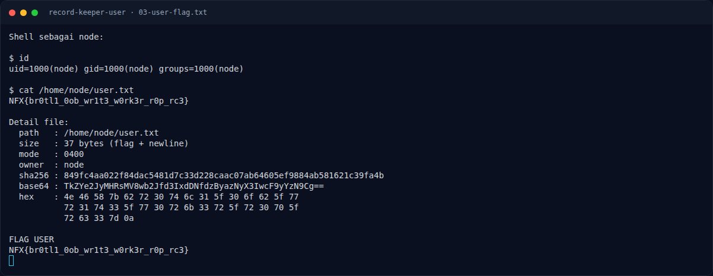

# Record Keeper (User) — Output

[← Overview](17-record-keeper-user.md) · [Index](index.md)

> **Langkah 6/9 — Output.** Output exploit mentah (alamat heap, token, ROP log) tidak disimpan di notes.
>
> **Titik penting:** cat /home/node/user.txt · NFX{br0tl1_0ob_wr1t3_w0rk3r_r0p_rc3} · uid=1000(node) gid=1000(node) groups=1000(node)
>
> **Berikutnya:** [Flag](17-record-keeper-user-07-flag.md)

## 3.3 Output

```text
uid=1000(node) gid=1000(node) groups=1000(node)

$ cat /home/node/user.txt
NFX{br0tl1_0ob_wr1t3_w0rk3r_r0p_rc3}
```

Output exploit mentah (alamat heap, token, ROP log) tidak disimpan di notes.
Bukti yang tersimpan adalah shell `node`, isi file flag, hash, base64, dan hex
yang dibaca ulang dari target.

### Evidence langkah ini



*Terminal evidence — `03-user-flag.txt` (arsip transkrip sesi solve).*

**Berkas mentah langkah ini:**

- [`03-user-flag.txt`](assets/record-keeper-user/03-user-flag.txt)
