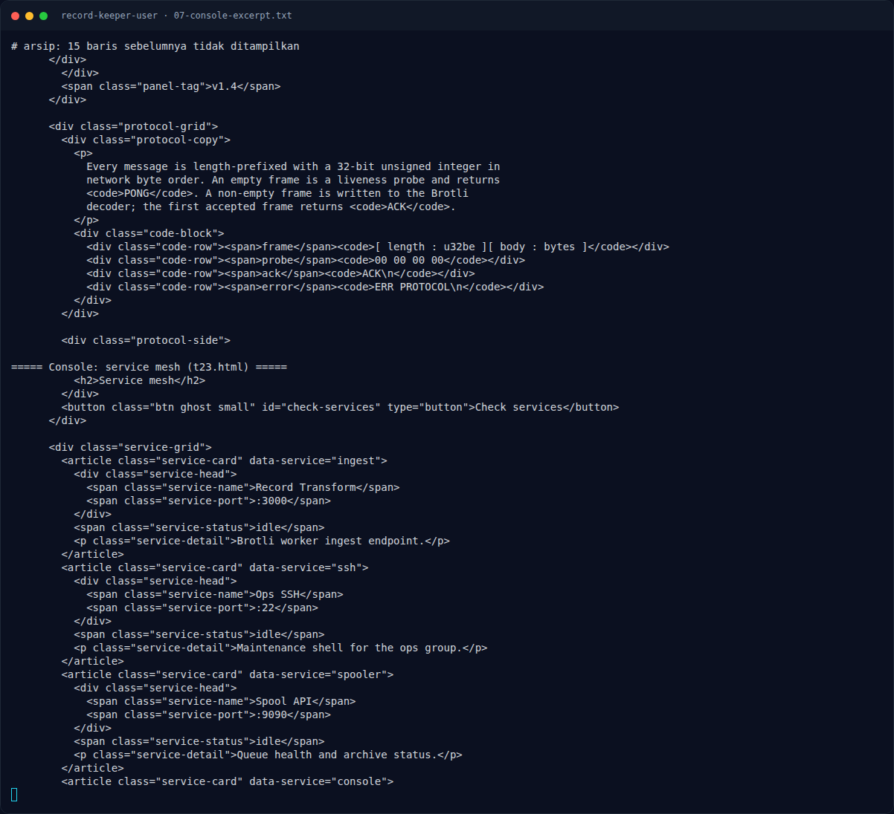

# Record Keeper (User) — Referensi

[← Overview](17-record-keeper-user.md) · [Index](index.md)

- Node.js 24.22.1 security release — CVE-2026-111497 (Brotli decoder).
- Node.js advisory / commit `0ed4268a4401abcb44720963` — block-switch format
  error.
- `Arkango/CVE-2026-111497` — exploit worker record transform.
- Imperva / Akamai / OX Security — analisis Node2Shell.
- Dokumentasi Node.js `zlib.createBrotliDecompress`.

### Evidence langkah ini

*Terminal evidence — `07-console-excerpt.txt` (arsip transkrip sesi solve).*
