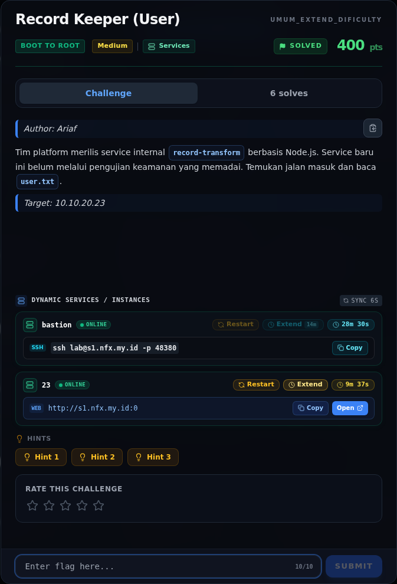
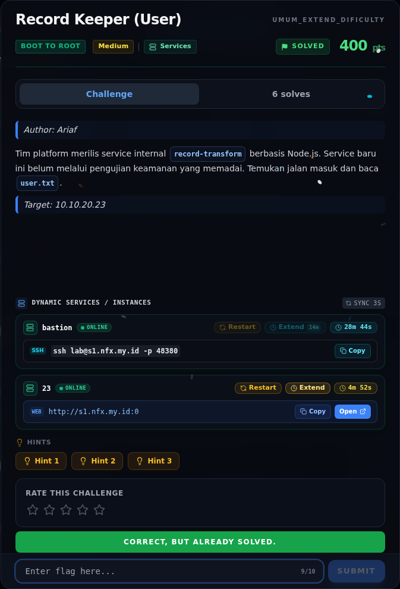

# Record Keeper (User)

Track Umum / Extend · Boot To RootMedium460 poinVERIFIED

| Field | Nilai |
|---|---|
| Event | `umum_Extend` |
| Kategori | `Boot To Root` |
| Difficulty | `Medium` |
| Poin | `460` |
| Author | `Ariaf` |
| Solves | `3` |
| Tools | nmap, curl, python3, sage, git |
| Flag | `NFX{br0tl1_0ob_wr1t3_w0rk3r_r0p_rc3}` |
| Status | `VERIFIED` |

[← Kembali ke Index](index.md)

## Challenge Brief (platform)

*Challenge brief asli di platform NFX CTF 2026.*

## Alur & Titik Penting

| # | Langkah | Titik penting | Buka |
|---:|---|---|---|
| 1 | Recon | nmap -Pn -sV -p- --min-rate 2000 10.10.20.23 | [Buka](17-record-keeper-user-01-recon.md) |
| 2 | Analisis | Dari dokumentasi console: | [Buka](17-record-keeper-user-02-analisis.md) |
| 3 | Analisis | 10.10.20.10 | [Buka](17-record-keeper-user-03-analisis-2.md) |
| 4 | Setelah RCE | Shell berjalan sebagai node. | [Buka](17-record-keeper-user-04-setelah-rce.md) |
| 5 | Eksploitasi / Solver | python3 /tmp/opencode/probe23.py 10.10.20.23 3000 | [Buka](17-record-keeper-user-05-eksploitasi-solver.md) |
| 6 | Output | cat /home/node/user.txt | [Buka](17-record-keeper-user-06-output.md) |
| 7 | Flag | NFX{br0tl1_0ob_wr1t3_w0rk3r_r0p_rc3} | [Buka](17-record-keeper-user-07-flag.md) |
| 8 | Bukti / Evidence | arsip screenshot dan transkrip | [Buka](17-record-keeper-user-08-bukti-evidence.md) |
| 9 | Referensi | — | [Buka](17-record-keeper-user-09-referensi.md) |

## Ringkasan

> **Catatan bukti.** Sumber utama adalah
> `flags/b2r/NexusRecordTransform.NOTES.md`, halaman console target yang
> tersimpan di `/tmp/opencode/t23.html`, dan artefak eksploit di
> `/tmp/opencode/arkango/` + `/tmp/opencode/rce_pkg/`. Raw `nmap` dan stdout
> penuh exploit tidak diarsipkan; langkah `[REKONSTRUKSI]` disusun dari
> temuan yang terdokumentasi, jadi bukan salinan transkrip mentah. Flag dan
> hash dicek ulang terhadap `flags/b2r/`.
## TL;DR

- Target `10.10.20.23` mengekspos empat service: console `:8080`,
  framed-TCP Brotli record transform `:3000`, OpenSSH `:22`, dan spool API
  `:9090`.
- Service `:3000` berjalan di **Node.js 24.9.0**, memakai
  `zlib.createBrotliDecompress({chunkSize: 0x330})`,
  `Buffer.allocUnsafeSlow(0x330)`, satu Worker per koneksi, dan
  `UV_THREADPOOL_SIZE=1`.
- Node.js 24.9.0 rentan **CVE-2026-111497 (Node2Shell)**: malformed Brotli
  stream memicu out-of-bounds write di decoder. Fixed di Node.js 24.22.1.
- Exploit `Arkango/CVE-2026-111497` dengan profile
  `node-24.9.0-worker-record-rce-bookworm-x86_64` melakukan heap grooming,
  menimpa return address, pivot ke ROP chain, lalu `execvp("/bin/bash", ...)`.
- Reverse shell balik ke bastion berjalan sebagai `uid=1000(node)`.
  `cat /home/node/user.txt` memberi flag:
  `NFX{br0tl1_0ob_wr1t3_w0rk3r_r0p_rc3}`.
- Submit pertama ditolak karena typo `w1r1t3` (kelebihan `1`); setelah
  dikoreksi menjadi `wr1t3`, platform menerima `+500 points`.

Pratinjau evidence. Buka halaman <a href="17-record-keeper-user-08-bukti-evidence.html">Evidence / Bukti</a> untuk semua screenshot dan transkrip.

## Navigasi Halaman

<a class="nx-page-card" href="17-record-keeper-user-01-recon.html"><b>Recon</b>Enumerasi target dan bukti awal</a>
<a class="nx-page-card" href="17-record-keeper-user-02-analisis.html"><b>Analisis</b>Membaca alur dan akar masalah</a>
<a class="nx-page-card" href="17-record-keeper-user-03-analisis-2.html"><b>Analisis</b>Membaca alur dan akar masalah</a>
<a class="nx-page-card" href="17-record-keeper-user-04-setelah-rce.html"><b>Setelah RCE</b>Baca bagian ini</a>
<a class="nx-page-card" href="17-record-keeper-user-05-eksploitasi-solver.html"><b>Eksploitasi / Solver</b>Langkah exploit dan solver</a>
<a class="nx-page-card" href="17-record-keeper-user-06-output.html"><b>Output</b>Baca bagian ini</a>
<a class="nx-page-card" href="17-record-keeper-user-07-flag.html"><b>Flag</b>Flag dan verifikasi platform</a>
<a class="nx-page-card" href="17-record-keeper-user-08-bukti-evidence.html"><b>Bukti / Evidence</b>Screenshot, transkrip, dan artefak</a>
<a class="nx-page-card" href="17-record-keeper-user-09-referensi.html"><b>Referensi</b>Sumber dan bacaan lanjutan</a>

