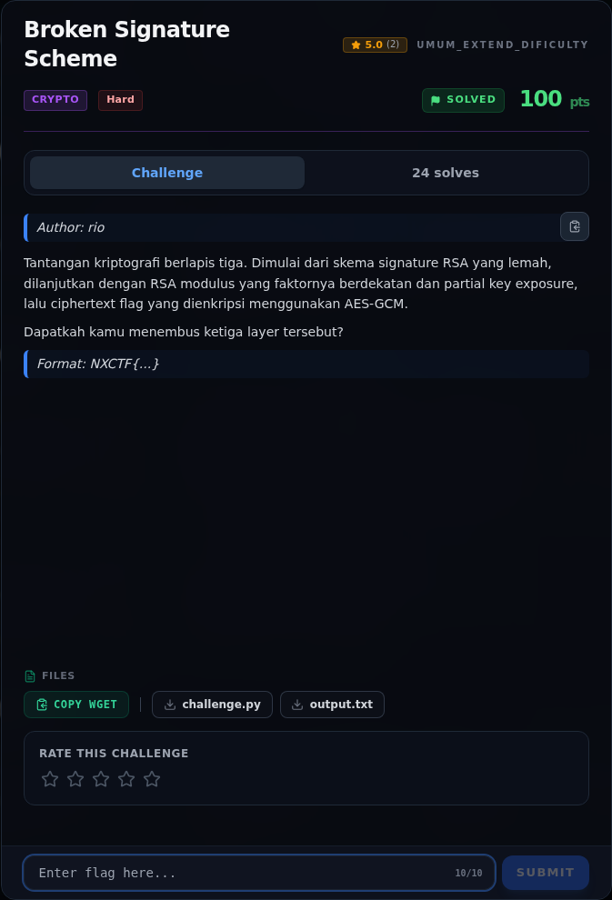

# Broken Signature Scheme — Layer 1 — RSA signature multiplicatif

[← Overview](18-broken-signature-scheme.md) · [Index](index.md)

> **Langkah 2/8 — Layer 1 — RSA signature multiplicatif.** Skema menandatangani pesan mentah:
>
> **Titik penting:** Skema menandatangani pesan mentah:
>
> **Berikutnya:** [Analisis](18-broken-signature-scheme-03-analisis.md)

## 2.1 Layer 1 — RSA signature multiplicatif

Skema menandatangani pesan mentah:

```text
sig(m) = m^d mod N
```

Karena fungsi RSA homomorfik multiplikatif:

```text
sig(m1) · sig(m2) ≡ (m1·m2)^d ≡ sig(m1·m2)  (mod N)
```

Target:

```text
target = 0x676976652d6d652d7468652d666c6167 = b"give-me-the-flag"
```

Enam pesan yang ditandatangani (sebagai integer hex):

```text
m0 = 0x51
m1 = 0x11b
m2 = 0x127a6a3b60a4ff3d22bfbb9863b15
m3 = 0xc161f7b3fe326517
m4 = 0xe2931d8da4fca785
m5 = 0xb1d824c70d64b4d9
```

Ternyata:

```text
m0 · m1 · m2 = 0x676976652d6d652d7468652d666c6167 = target
```

Jadi signature target dapat dipalsukan tanpa private key:

```text
sig_forge = (sig0 · sig1 · sig2) mod N
```

Verifikasi: `sig_forge^e mod N == target`. Ini lolos karena tidak ada hashing
dan tidak ada padding pada pesan.

### Evidence langkah ini



*Challenge brief asli di platform NFX CTF 2026.*
