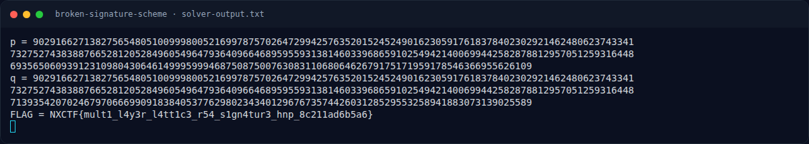
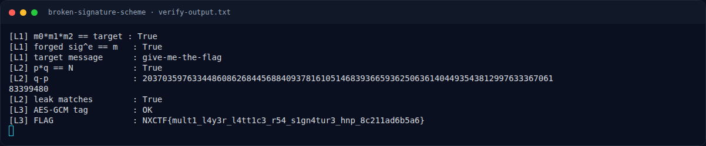

# Broken Signature Scheme — Solver

[← Overview](18-broken-signature-scheme.md) · [Index](index.md)

## 3.1 Script lengkap

Tersimpan di `writeups/assets/broken-signature-scheme/solve.py`:

```python
import json, hashlib, math
from Crypto.Cipher import AES

d = json.load(open("output.txt"))
N = int(d["N"], 16)
leak = int(d["leak"], 16)
pos, lb, db = d["leak_pos"], d["leak_bits"], d["delta_bits"]

# q = nextprime(p + 2^db)  =>  delta = 2^db + small gap
# N = p(p+delta), discriminant delta^2+4N must be a perfect square
base = 1 << db
p = q = None
for g in range(200000):
    delta = base + g
    D = delta * delta + 4 * N
    s = math.isqrt(D)
    if s * s != D or (s - delta) % 2:
        continue
    cand = (s - delta) // 2
    if cand * (cand + delta) == N and ((cand >> pos) & ((1 << lb) - 1)) == leak:
        p, q = cand, cand + delta
        break
assert p and q and p * q == N
print("p =", p)
print("q =", q)

qc = d["flag_cipher"]
ct = bytes.fromhex(qc["ct_hex"])
nonce = bytes.fromhex(qc["nonce_hex"])
tag = bytes.fromhex(qc["tag_hex"])
enc = (p.to_bytes((p.bit_length() + 7) // 8, "big")
       + q.to_bytes((q.bit_length() + 7) // 8, "big"))
key = hashlib.sha256(enc).digest()
pt = AES.new(key, AES.MODE_GCM, nonce=nonce).decrypt_and_verify(ct, tag)
print("FLAG =", pt.decode())
```

## 3.2 Layer 1 — forge signature (demonstrasi)

```python
import json
d = json.load(open("output.txt"))
N, e = int(d["N"], 16), d["e"]
msgs = [int(s["msg"], 16) for s in d["valid_sigs"]]
sigs = [int(s["sig"], 16) for s in d["valid_sigs"]]
m = (msgs[0] * msgs[1] * msgs[2]) % N
s = (sigs[0] * sigs[1] * sigs[2]) % N
assert m == int(d["target_msg_hex"], 16)
assert pow(s, e, N) == m
print("forged signature valid for:", bytes.fromhex(d["target_msg_hex"]).decode())
```

### Evidence langkah ini



*Terminal evidence — `solver-output.txt` (arsip transkrip sesi solve).*



*Terminal evidence — `verify-output.txt` (arsip transkrip sesi solve).*
