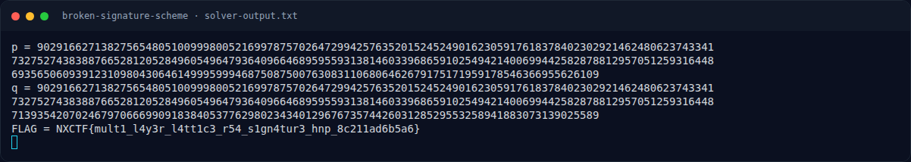
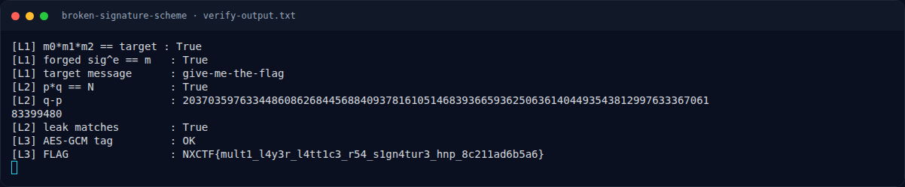

# Broken Signature Scheme — Solver

[← Overview](18-broken-signature-scheme.md) · [Index](index.md)

## 3.3 Output asli

```text
$ cd crypto/Broken_Signature_Scheme_Multi_Layer
$ python3 solve.py
p = 90291662713827565480510099980052169978757026472994257635201524524901623059176183784023029214624806237433417327527438388766528120528496054964793640966468959559313814603396865910254942140069944258287881295705125931644869356506093912310980430646149995999468750875007630831106806462679175171959178546366955626109
q = 90291662713827565480510099980052169978757026472994257635201524524901623059176183784023029214624806237433417327527438388766528120528496054964793640966468959559313814603396865910254942140069944258287881295705125931644871393542070246797066699091838405377629802343401296767357442603128529553258941883073139025589
FLAG = NXCTF{mult1_l4y3r_l4tt1c3_r54_s1gn4tur3_hnp_8c211ad6b5a6}
```

## 3.4 Verifikasi tiga layer

Script `writeups/assets/broken-signature-scheme/verify.py`:

```text
$ python3 verify.py
[L1] m0*m1*m2 == target : True
[L1] forged sig^e == m   : True
[L1] target message      : give-me-the-flag
[L2] p*q == N            : True
[L2] q-p                 : 2037035976334486086268445688409378161051468393665936250636140449354381299763336706183399480
[L2] leak matches        : True
[L3] AES-GCM tag         : OK
[L3] FLAG                : NXCTF{mult1_l4y3r_l4tt1c3_r54_s1gn4tur3_hnp_8c211ad6b5a6}
```

### Evidence langkah ini



*Terminal evidence — `solver-output.txt` (arsip transkrip sesi solve).*



*Terminal evidence — `verify-output.txt` (arsip transkrip sesi solve).*

**Berkas mentah langkah ini:**

- [`solver-output.txt`](assets/broken-signature-scheme/solver-output.txt)
- [`verify-output.txt`](assets/broken-signature-scheme/verify-output.txt)
