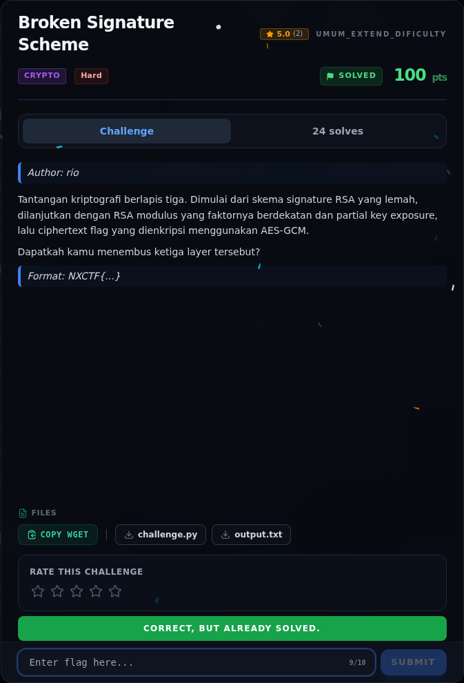

# Broken Signature Scheme — Flag & Verifikasi

[← Overview](18-broken-signature-scheme.md) · [Index](index.md)

> **Langkah 6/8 — Flag.** Verifikasi (log submit asli):
>
> **Titik penting:** NXCTF{mult1_l4y3r_l4tt1c3_r54_s1gn4tur3_hnp_8c211ad6b5a6}
>
> **Berikutnya:** [Bukti / Evidence](18-broken-signature-scheme-07-bukti-evidence.md)

> **Flag:** `NXCTF{mult1_l4y3r_l4tt1c3_r54_s1gn4tur3_hnp_8c211ad6b5a6}`
> **Status:** `VERIFIED`

```text
NXCTF{mult1_l4y3r_l4tt1c3_r54_s1gn4tur3_hnp_8c211ad6b5a6}
```

Verifikasi (log submit asli):

```json
{"time": 1794056594.0404963, "id": "17c53978-d039-4ce8-9111-bf6515d5c1b2",
 "title": "Broken Signature Scheme",
 "flag": "NXCTF{mult1_l4y3r_l4tt1c3_r54_s1gn4tur3_hnp_8c211ad6b5a6}",
 "http": 200,
 "result": {"success": true, "message": "Correct! +500 points."}}
```

### Bukti submit di platform



*Submit flag di platform: `CORRECT, BUT ALREADY SOLVED.`*

> **Bukti submit:** screenshot form challenge di atas menampilkan `CORRECT, BUT ALREADY SOLVED.`
