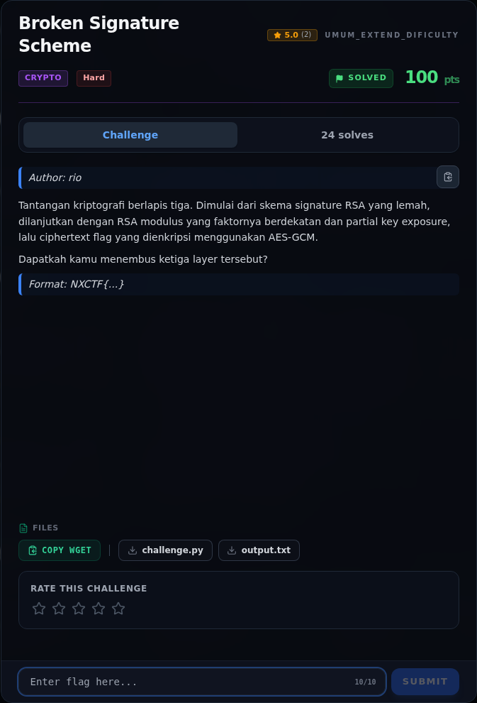

# Broken Signature Scheme — Referensi

[← Overview](18-broken-signature-scheme.md) · [Index](index.md)

> **Langkah 8/8 — Referensi.** Referensi
>
> **Titik penting:** —
>
> **Selesai.** Kembali ke [Overview](18-broken-signature-scheme.md).

- RSA signature forgery — homomorphic multiplicative property.
- Coppersmith / close-prime factorization.
- Fermat factorization dan diskriminan kuadrat.
- NIST SP 800-38D — AES-GCM.

### Evidence langkah ini

*Challenge brief asli di platform NFX CTF 2026.*
