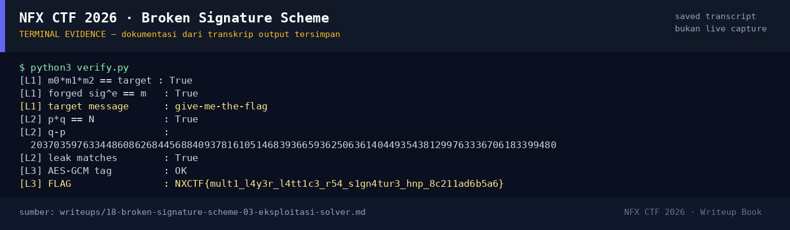

# Broken Signature Scheme

Track Umum / Extend · CryptoHard180 poinVERIFIED

| Field | Nilai |
|---|---|
| Event | `umum_Extend` |
| Kategori | `Crypto` |
| Difficulty | `Hard` |
| Poin | `180` |
| Author | `rio` |
| Solves | `17` |
| Tools | python3, sage |
| Flag | `NXCTF{mult1_l4y3r_l4tt1c3_r54_s1gn4tur3_hnp_8c211ad6b5a6}` |
| Status | `VERIFIED` |

[← Kembali ke Index](index.md)

## TL;DR

Challenge punya tiga lapisan:

1. **Signature RSA multiplicatif.** `sig(m) = m^d mod N` (tanpa hash).
   Target `give-me-the-flag` tepat sama dengan produk tiga pesan yang sudah
   ditandatangani, jadi signature target = produk ketiga signature.
2. **RSA close-prime + partial leak.** `q = nextprime(p + 2^300)`, sehingga
   `δ = q-p = 2^300 + g` dengan `g` kecil. Diskriminan
   `δ² + 4N = (p+q)²` harus kuadrat sempurna. Enumerasi `g < 200.000` dan
   filter 20 bit bocor di posisi 500 menemukan `p,q`.
3. **AES-GCM.** Key = `SHA256(p||q)`, lalu `decrypt_and_verify` membuka flag.

Pratinjau evidence. Buka halaman <a href="18-broken-signature-scheme-05-bukti-evidence.html">Evidence / Bukti</a> untuk semua screenshot dan transkrip.

## Navigasi Halaman

<a class="nx-page-card" href="18-broken-signature-scheme-01-recon.html"><b>Recon</b>Enumerasi target dan bukti awal</a>
<a class="nx-page-card" href="18-broken-signature-scheme-02-analisis.html"><b>Analisis</b>Membaca alur dan akar masalah</a>
<a class="nx-page-card" href="18-broken-signature-scheme-03-eksploitasi-solver.html"><b>Eksploitasi / Solver</b>Langkah exploit dan solver</a>
<a class="nx-page-card" href="18-broken-signature-scheme-04-flag.html"><b>Flag</b>Flag dan verifikasi platform</a>
<a class="nx-page-card" href="18-broken-signature-scheme-05-bukti-evidence.html"><b>Bukti / Evidence</b>Screenshot, transkrip, dan artefak</a>
<a class="nx-page-card" href="18-broken-signature-scheme-06-referensi.html"><b>Referensi</b>Sumber dan bacaan lanjutan</a>

