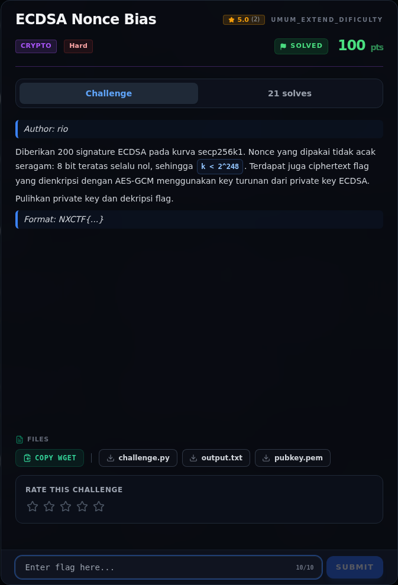

# ECDSA Nonce Bias — Analisis

[← Overview](19-ecdsa-nonce-bias.md) · [Index](index.md)

> **Langkah 2/7 — Analisis.** Untuk setiap signature:
>
> **Titik penting:** Untuk setiap signature:
>
> **Berikutnya:** [Script lengkap](19-ecdsa-nonce-bias-03-script-lengkap.md)

### 2.1 Persamaan ECDSA

Untuk setiap signature:

```text
s_i = k_i^{-1} (h_i + d·r_i)  (mod n)
```

dengan `d` private key, `k_i` nonce, `h_i` hash pesan, `r_i` koordinat x
dari `k_i·G`.

Karena `k_i < B = 2^248`, tulis:

```text
k_i = (h_i + d·r_i) · s_i^{-1} mod n
    = a_i + b_i·d mod n
```

dengan:

```text
a_i = h_i · s_i^{-1} mod n
b_i = r_i · s_i^{-1} mod n
```

Setiap signature memberi persamaan linear dalam `d` dengan error
`k_i` yang kecil (`< 2^248`, sedangkan `n ≈ 2^256`). Ini persis HNP.

### 2.2 Lattice HNP

Susun basis dimensi `m+2` (m = jumlah signature yang dipakai):

```text
[ n²·I_m        0      0  ]
[ n·b_1 ... n·b_m   B   0 ]
[ n·a_1 ... n·a_m   0  nB ]
```

Kombinasi integer yang menyertakan `d` pada baris kedua dan `1` pada baris
ketiga menghasilkan vektor dengan:

- koordinat pertama `≈ n·k_i` (kecil karena `k_i < B`),
- koordinat kedua `= d·B`,
- koordinat ketiga `= n·B`.

Setelah LLL, koordinat kedua dari vektor pendek memberi `d·B`, sehingga
`d = koordinat / B mod n`. Solver mencoba `m = 50, 60, 80, 100, 120`;
`m=50` sudah berhasil.

### 2.3 Dari private key ke flag

`challenge.py` memberi hint:

```text
key AES-GCM = SHA256(d), d dalam 32 byte big-endian
```

Jadi:

```text
key = SHA256(d.to_bytes(32, "big"))
pt  = AESGCM(key, nonce).decrypt_and_verify(ct, tag)
```

### 2.4 Verifikasi key

Tiga pemeriksaan independen:

1. `d·G == pubkey.pointQ` (x dan y).
2. Untuk semua 200 signature, `k_i = (h_i + d·r_i)·s_i^{-1} mod n < 2^248`.
3. AES-GCM `decrypt_and_verify` tidak melempar exception.

### Evidence langkah ini



*Challenge brief asli di platform NFX CTF 2026.*
