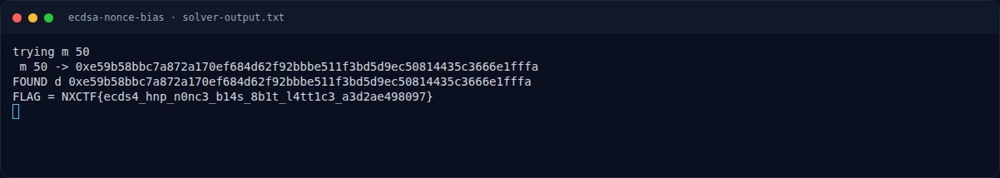
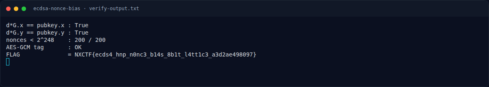

# ECDSA Nonce Bias — Script lengkap

[← Overview](19-ecdsa-nonce-bias.md) · [Index](index.md)

> **Langkah 3/7 — Script lengkap.** Tersimpan di writeups/assets/ecdsa-nonce-bias/solve.py:
>
> **Titik penting:** Tersimpan di writeups/assets/ecdsa-nonce-bias/solve.py:
>
> **Berikutnya:** [Solver](19-ecdsa-nonce-bias-04-solver.md)

## 3.1 Script lengkap

Tersimpan di `writeups/assets/ecdsa-nonce-bias/solve.py`:

```python
import json, hashlib
from fpylll import IntegerMatrix, LLL, BKZ
from Crypto.Cipher import AES

d = json.load(open("output.txt"))
n = int(d["n"], 16)
sigs = d["signatures"]
B = 1 << 248

def check_d(dd):
    if dd <= 0 or dd >= n:
        return False
    for sig in sigs:
        r = int(sig["r"], 16)
        s = int(sig["s"], 16)
        h = int(sig["h"], 16)
        k = (h + dd * r) * pow(s, -1, n) % n
        if k >= B:
            return False
    return True

def attempt(m, bkz=False):
    aa = []
    bb = []
    for sig in sigs[:m]:
        r = int(sig["r"], 16)
        s = int(sig["s"], 16)
        h = int(sig["h"], 16)
        si = pow(s, -1, n)
        aa.append((h * si) % n)
        bb.append((r * si) % n)
    dim = m + 2
    M = IntegerMatrix(dim, dim)
    n2 = n * n
    for i in range(m):
        M[i, i] = n2
    for i in range(m):
        M[m, i] = bb[i] * n
        M[m + 1, i] = aa[i] * n
    M[m, m] = B
    M[m + 1, m + 1] = n * B
    if bkz:
        BKZ.reduction(M, BKZ.Param(block_size=20))
    else:
        LLL.reduction(M, delta=0.99)
    cands = set()
    for i in range(dim):
        row = [M[i, j] for j in range(dim)]
        if row[m] != 0 and row[m] % B == 0:
            cands.add((row[m] // B) % n)
            cands.add((-(row[m] // B)) % n)
    for dd in cands:
        if check_d(dd):
            return dd
    return None

for m in [50, 60, 80, 100, 120]:
    print("trying m", m, flush=True)
    dd = attempt(m)
    print(" m", m, "->", hex(dd) if dd else None, flush=True)
    if dd:
        print("FOUND d", hex(dd))
        fc = d["flag_ciphertext"]
        key = hashlib.sha256(dd.to_bytes(32, "big")).digest()
        pt = AES.new(key, AES.MODE_GCM,
                     nonce=bytes.fromhex(fc["nonce_hex"])).decrypt_and_verify(
            bytes.fromhex(fc["ct_hex"]), bytes.fromhex(fc["tag_hex"]))
        print("FLAG =", pt.decode())
        break
```

### Evidence langkah ini



*Terminal evidence — `solver-output.txt` (arsip transkrip sesi solve).*



*Terminal evidence — `verify-output.txt` (arsip transkrip sesi solve).*

**Berkas mentah langkah ini:**

- [`solver-output.txt`](assets/ecdsa-nonce-bias/solver-output.txt)
- [`verify-output.txt`](assets/ecdsa-nonce-bias/verify-output.txt)
