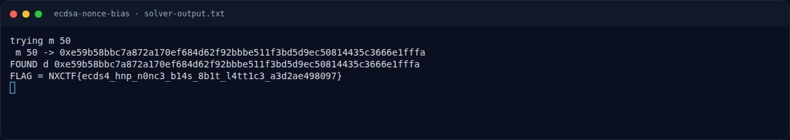
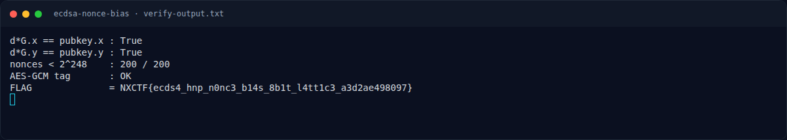

# ECDSA Nonce Bias — Solver

[← Overview](19-ecdsa-nonce-bias.md) · [Index](index.md)

> **Langkah 4/7 — Solver.** Script docs/assets/ecdsa-nonce-bias/verify.py:
>
> **Titik penting:** python3 docs/assets/ecdsa-nonce-bias/solve.py · python3 verify.py
>
> **Berikutnya:** [Flag](19-ecdsa-nonce-bias-05-flag.md)

## 3.2 Output asli

```text
$ python3 docs/assets/ecdsa-nonce-bias/solve.py
trying m 50
 m 50 -> 0xe59b58bbc7a872a170ef684d62f92bbbe511f3bd5d9ec50814435c3666e1fffa
FOUND d 0xe59b58bbc7a872a170ef684d62f92bbbe511f3bd5d9ec50814435c3666e1fffa
FLAG = NXCTF{ecds4_hnp_n0nc3_b14s_8b1t_l4tt1c3_a3d2ae498097}
```

## 3.3 Verifikasi

Script `docs/assets/ecdsa-nonce-bias/verify.py`:

```text
$ python3 verify.py
d*G.x == pubkey.x : True
d*G.y == pubkey.y : True
nonces < 2^248    : 200 / 200
AES-GCM tag       : OK
FLAG              = NXCTF{ecds4_hnp_n0nc3_b14s_8b1t_l4tt1c3_a3d2ae498097}
```

Private key lengkap:

```text
d = 0xe59b58bbc7a872a170ef684d62f92bbbe511f3bd5d9ec50814435c3666e1fffa
```

### Evidence langkah ini



*Terminal evidence — `solver-output.txt` (arsip transkrip sesi solve).*



*Terminal evidence — `verify-output.txt` (arsip transkrip sesi solve).*

**Berkas mentah langkah ini:**

- [`solver-output.txt`](assets/ecdsa-nonce-bias/solver-output.txt)
- [`verify-output.txt`](assets/ecdsa-nonce-bias/verify-output.txt)
