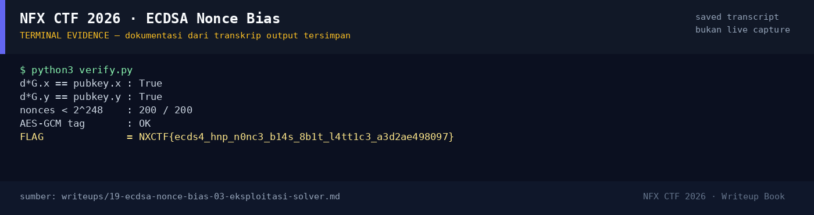

# ECDSA Nonce Bias — Evidence / Bukti

1 screenshot4 transkrip / script

[← Overview](19-ecdsa-nonce-bias.md) · [Index](index.md)

## Arsip Evidence

> Semua file di bawah berasal dari folder `assets/ecdsa-nonce-bias/`. Screenshot ditempel langsung; file teks/script ditautkan.

### Screenshot

<figure><figcaption>98-terminal-evidence.png</figcaption></figure>

### Transkrip / file pendukung

- [`solve.py`](assets/ecdsa-nonce-bias/solve.py)
- [`solver-output.txt`](assets/ecdsa-nonce-bias/solver-output.txt)
- [`verify-output.txt`](assets/ecdsa-nonce-bias/verify-output.txt)
- [`verify.py`](assets/ecdsa-nonce-bias/verify.py)

## Tabel Evidence

| Bukti | File | Keterangan |
|---|---|---|
| Hash input | `assets/checksums-all.txt` | SHA-256 ketiga file |
| Solver | `assets/ecdsa-nonce-bias/solve.py` | HNP lattice m=50 |
| Output solver | `assets/ecdsa-nonce-bias/solver-output.txt` | `d`, flag |
| Verifikasi | `assets/ecdsa-nonce-bias/verify.py` / `verify-output.txt` | `d·G`, 200 nonce, tag |
| Log submit | `work/wave2_submit_parallel.jsonl` | Flag diterima platform |