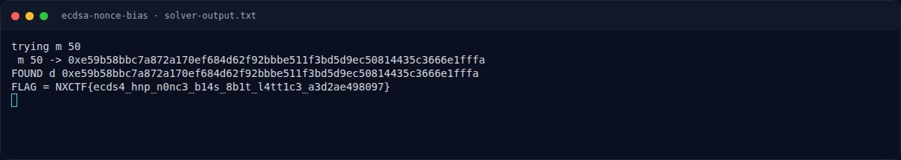

# ECDSA Nonce Bias — Flag & Verifikasi

[← Overview](19-ecdsa-nonce-bias.md) · [Index](index.md)

> **Langkah 5/7 — Flag.** Verifikasi (log submit asli):
>
> **Titik penting:** NXCTF{ecds4_hnp_n0nc3_b14s_8b1t_l4tt1c3_a3d2ae498097}
>
> **Berikutnya:** [Bukti / Evidence](19-ecdsa-nonce-bias-06-bukti-evidence.md)

> **Flag:** `NXCTF{ecds4_hnp_n0nc3_b14s_8b1t_l4tt1c3_a3d2ae498097}`
> **Status:** `VERIFIED`

```text
NXCTF{ecds4_hnp_n0nc3_b14s_8b1t_l4tt1c3_a3d2ae498097}
```

Verifikasi (log submit asli):

```json
{"time": 1794056594.0416405, "id": "78d47118-41f6-4f56-b6ac-7b8ddae9b54f",
 "title": "ECDSA Nonce Bias",
 "flag": "NXCTF{ecds4_hnp_n0nc3_b14s_8b1t_l4tt1c3_a3d2ae498097}",
 "http": 200,
 "result": {"success": true, "message": "Correct! +500 points."}}
```

### Terminal evidence (real)



*Terminal evidence (real).*

> **Bukti:** terminal evidence (real).
