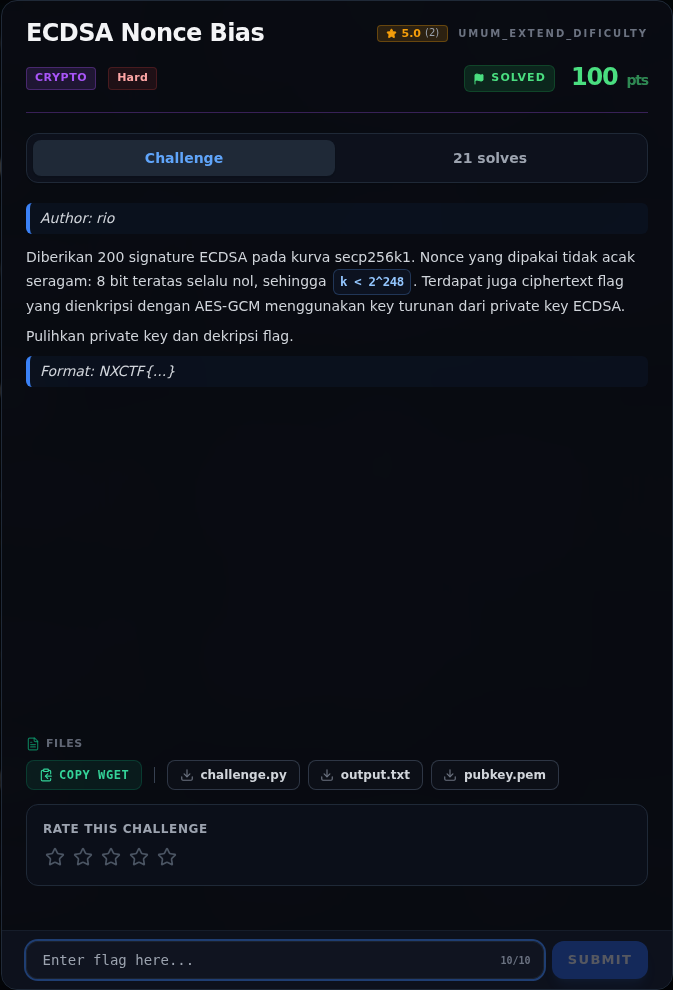
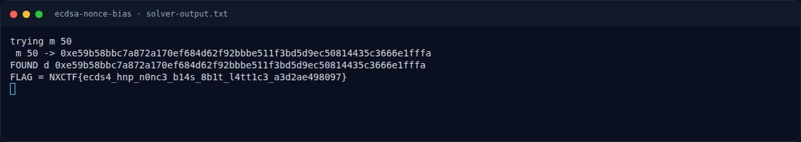
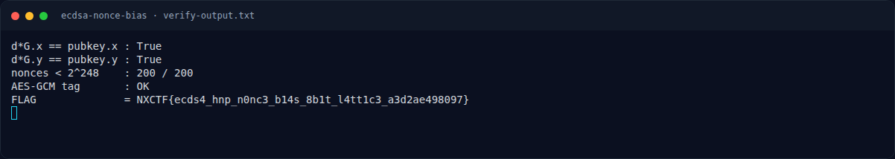

# ECDSA Nonce Bias — Evidence / Bukti

4 screenshot4 transkrip / script

[← Overview](19-ecdsa-nonce-bias.md) · [Index](index.md)

> **Langkah 6/7 — Bukti / Evidence.** Bukti / Evidence
>
> **Titik penting:** arsip screenshot dan transkrip
>
> **Berikutnya:** [Referensi](19-ecdsa-nonce-bias-07-referensi.md)

## Arsip Evidence

> Semua file berasal dari `assets/ecdsa-nonce-bias/`. Screenshot platform dan terminal adalah bukti asli dari sesi solve; transkrip mentah tetap ditautkan di bagian bawah.

### Platform

<figure><figcaption>00-challenge-platform.png</figcaption></figure>

*Challenge brief asli di platform NFX CTF 2026.*

<figure><figcaption>Terminal evidence (real)</figcaption></figure>

*Terminal evidence (real).*

### Terminal (arsip sesi)

<figure><figcaption>term-solver-output.png</figcaption></figure>

*Terminal evidence — `solver-output.txt` (arsip transkrip sesi solve).*

<figure><figcaption>term-verify-output.png</figcaption></figure>

*Terminal evidence — `verify-output.txt` (arsip transkrip sesi solve).*

### Transkrip mentah & script

- [`solve.py`](assets/ecdsa-nonce-bias/solve.py)
- [`solver-output.txt`](assets/ecdsa-nonce-bias/solver-output.txt)
- [`verify-output.txt`](assets/ecdsa-nonce-bias/verify-output.txt)
- [`verify.py`](assets/ecdsa-nonce-bias/verify.py)

## Tabel Evidence

| Bukti | File | Keterangan |
|---|---|---|
| Hash input | `assets/checksums-all.txt` | SHA-256 ketiga file |
| Solver | `assets/ecdsa-nonce-bias/solve.py` | HNP lattice m=50 |
| Output solver | `assets/ecdsa-nonce-bias/solver-output.txt` | `d`, flag |
| Verifikasi | `assets/ecdsa-nonce-bias/verify.py` / `verify-output.txt` | `d·G`, 200 nonce, tag |
| Log submit | `work/wave2_submit_parallel.jsonl` | Flag diterima platform |