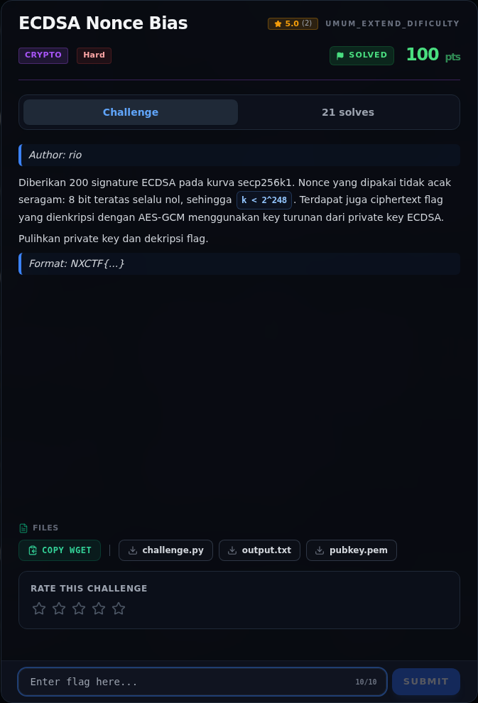

# ECDSA Nonce Bias — Referensi

[← Overview](19-ecdsa-nonce-bias.md) · [Index](index.md)

> **Langkah 7/7 — Referensi.** secret keys in Diffie-Hellman and related schemes (HNP).
>
> **Titik penting:** secret keys in Diffie-Hellman and related schemes (HNP).
>
> **Selesai.** Kembali ke [Overview](19-ecdsa-nonce-bias.md).

- Boneh & Venkatesan, *Hardness of computing the most significant bits of
  secret keys in Diffie-Hellman and related schemes* (HNP).
- Nguyen & Shparlinski, *The insecurity of the Digital Signature Algorithm
  with partially known nonces*.
- RFC 6979 — Deterministic ECDSA.
- `fpylll` LLL/BKZ documentation.

### Evidence langkah ini

*Challenge brief asli di platform NFX CTF 2026.*
