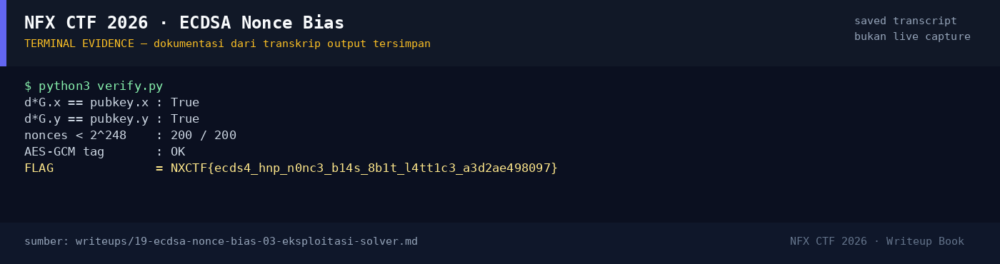

# ECDSA Nonce Bias

Track Umum / Extend · CryptoHard260 poinVERIFIED

| Field | Nilai |
|---|---|
| Event | `umum_Extend` |
| Kategori | `Crypto` |
| Difficulty | `Hard` |
| Poin | `260` |
| Author | `rio` |
| Solves | `13` |
| Tools | python3, sage, fpylll, git |
| Flag | `NXCTF{ecds4_hnp_n0nc3_b14s_8b1t_l4tt1c3_a3d2ae498097}` |
| Status | `VERIFIED` |

[← Kembali ke Index](index.md)

## TL;DR

- 200 signature ECDSA pada `secp256k1`; nonce `k` selalu `< 2^248`
  (8 bit teratas nol).
- Ini **Hidden Number Problem (HNP)**: dari
  `s = k^{-1}(h + d·r) mod n`, nonce kecil memberi
  `k_i = a_i + b_i·d mod n` dengan `a_i = h_i s_i^{-1}`,
  `b_i = r_i s_i^{-1}`, dan `k_i < B = 2^248`.
- Lattice HNP dengan 50 signature + LLL memulihkan private key `d`.
- Verifikasi: `d·G` sama dengan public key, 200/200 nonce `< 2^248`,
  dan AES-GCM tag valid.
- Flag: `NXCTF{ecds4_hnp_n0nc3_b14s_8b1t_l4tt1c3_a3d2ae498097}`.

Pratinjau evidence. Buka halaman <a href="19-ecdsa-nonce-bias-05-bukti-evidence.html">Evidence / Bukti</a> untuk semua screenshot dan transkrip.

## Navigasi Halaman

<a class="nx-page-card" href="19-ecdsa-nonce-bias-01-recon.html"><b>Recon</b>Enumerasi target dan bukti awal</a>
<a class="nx-page-card" href="19-ecdsa-nonce-bias-02-analisis.html"><b>Analisis</b>Membaca alur dan akar masalah</a>
<a class="nx-page-card" href="19-ecdsa-nonce-bias-03-eksploitasi-solver.html"><b>Eksploitasi / Solver</b>Langkah exploit dan solver</a>
<a class="nx-page-card" href="19-ecdsa-nonce-bias-04-flag.html"><b>Flag</b>Flag dan verifikasi platform</a>
<a class="nx-page-card" href="19-ecdsa-nonce-bias-05-bukti-evidence.html"><b>Bukti / Evidence</b>Screenshot, transkrip, dan artefak</a>
<a class="nx-page-card" href="19-ecdsa-nonce-bias-06-referensi.html"><b>Referensi</b>Sumber dan bacaan lanjutan</a>

