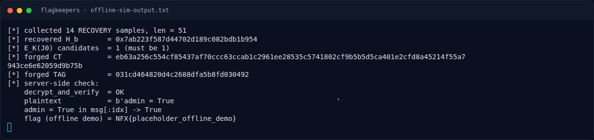

# FlagKeepers — Helper GF(2^128) / GHASH

[← Overview](20-flagkeepers.md) · [Index](index.md)

> **Langkah 3/8 — Helper GF(2^128) / GHASH.** Tersimpan di writeups/assets/flagkeepers/gcmtool.py.
>
> **Titik penting:** Tersimpan di writeups/assets/flagkeepers/gcmtool.py.
>
> **Berikutnya:** [Solver](20-flagkeepers-04-solver.md)

## 3.1 Helper GF(2^128) / GHASH

Tersimpan di `writeups/assets/flagkeepers/gcmtool.py`. Fungsi inti:

```python
MASK = (1 << 128) - 1

def gf_mul(x, y):
    z = 0; v = x & MASK
    for i in range(128):
        if (y >> (127 - i)) & 1:
            z ^= v
        if v & 1:
            v = (v >> 1) ^ (0xE1 << 120)
        else:
            v >>= 1
    return z & MASK

def ghash(h, ct, aad=b""):
    y = 0
    for b in blocks16(aad):
        y = gf_mul(y ^ b, h)
    for b in blocks16(ct):
        y = gf_mul(y ^ b, h)
    L = ((len(aad) * 8) << 64) | (len(ct) * 8)
    return gf_mul(y ^ L, h)

def ekj0(key, nonce):
    return int.from_bytes(
        AES.new(key, AES.MODE_ECB).encrypt(nonce + b"\0\0\0\1"), "big")

def hkey(key):
    return int.from_bytes(AES.new(key, AES.MODE_ECB).encrypt(b"\0" * 16), "big")
```

`recover_H_general()` membangun persamaan dari semua pasangan sampel:

```python
for i in range(n):
    for j in range(i + 1, n):
        c1, t1 = pairs[i]; c2, t2 = pairs[j]
        b1 = blocks16(c1); b2 = blocks16(c2)
        coeff = {}
        for k in range(1, nblocks + 1):
            e = nblocks - k + 2
            d = b1[k-1] ^ b2[k-1]
            if d:
                coeff[e] = coeff.get(e, 0) ^ d
        # coeff[e] adalah koefisien H^e, rhs = t1 ^ t2
```

lalu eliminasi Gaussian di GF(2^128), dan memilih `H` yang membuat
`tag XOR ghash(H, ct)` konstan di semua sampel.

### Evidence langkah ini



*Terminal evidence — `offline-sim-output.txt` (arsip transkrip sesi solve).*

**Berkas mentah langkah ini:**

- [`offline-sim-output.txt`](assets/flagkeepers/offline-sim-output.txt)
