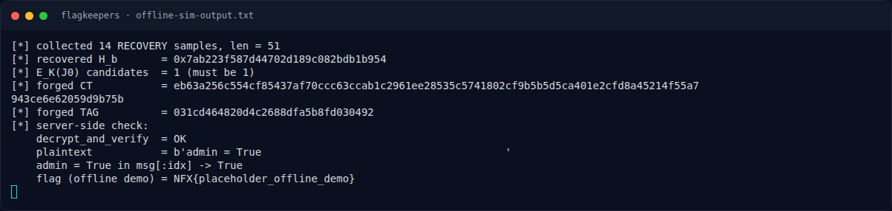

# FlagKeepers — Solver

[← Overview](20-flagkeepers.md) · [Index](index.md)

## 3.2 Exploit live

Tersimpan di `writeups/assets/flagkeepers/exploit_live.py` (ringkas):

```python
samples = []
for i in range(14):
    s.sendall(b"2\n")
    txt = recv_until()
    nonce, msg, ct, tag = parse(txt)
    samples.append((msg, ct, int.from_bytes(tag, "big")))

pairs = [(ct, t) for m, ct, t in samples]
H = recover_H_general(pairs, (len(samples[0][1]) + 15) // 16)
assert H is not None

Es = {t ^ ghash(H, ct) for m, ct, t in samples}
assert len(Es) == 1
E0 = next(iter(Es))

P0, C0, _ = samples[0]
KS = bytes(a ^ b for a, b in zip(P0, C0))

P = b"admin = True" + b" " * 39
CT = bytes(a ^ b for a, b in zip(P, KS))
TAG = ghash(H, CT) ^ E0

s.sendall(b"4\n")
s.sendall(CT.hex().encode() + b"\n")
s.sendall(TAG.to_bytes(16, "big").hex().encode() + b"\n")
print(recv_until())
```

## 3.3 Output live asli

Log `writeups/assets/flagkeepers/live_run.log`:

```text
[banner ok] 210
[sample0] msg= b'RECOVERY|ts=1794053560|r=1de81f84|t=fdaef5b11644|OK'
[sample0] ctlen 51 tag 2a0ccbabce92a0e321d862330ad3dc9a
[collected] 14 idx 32
[msg lengths] {51}
[H] 0x26493fa6231e531baf7ba6bf77c84b50
[E_K(J0) consistency] 1
[forged] plaintext= b'admin = True                                       '
[forged] ct= 953f210a7913d6a2e4211f1fe7fa4082716ce1d2bc88c1e8bd712e3becae698a013b4e3d955aef26d4f6983e844488fbb5ed70
[forged] tag= ced4419767ad26b3c4801c6aca6fb644
[final idx] 32
[opt4 ct prompt] CT: 
[opt4 tag prompt] Tag: 
[RESULT] NFX{gcm_f0rb1dd3n_4tt4ck_du4l_t4g_c0ll1s10n_m4st3r}
```

### Evidence langkah ini



*Terminal evidence — `offline-sim-output.txt` (arsip transkrip sesi solve).*

**Berkas mentah langkah ini:**

- [`offline-sim-output.txt`](assets/flagkeepers/offline-sim-output.txt)
