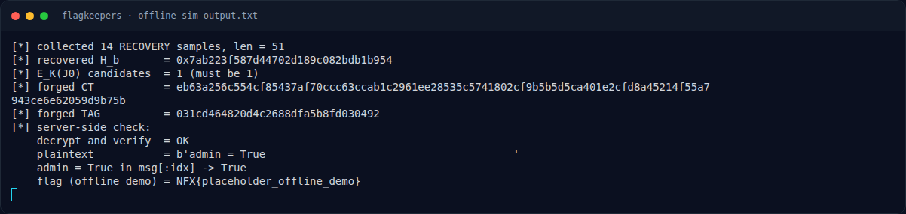
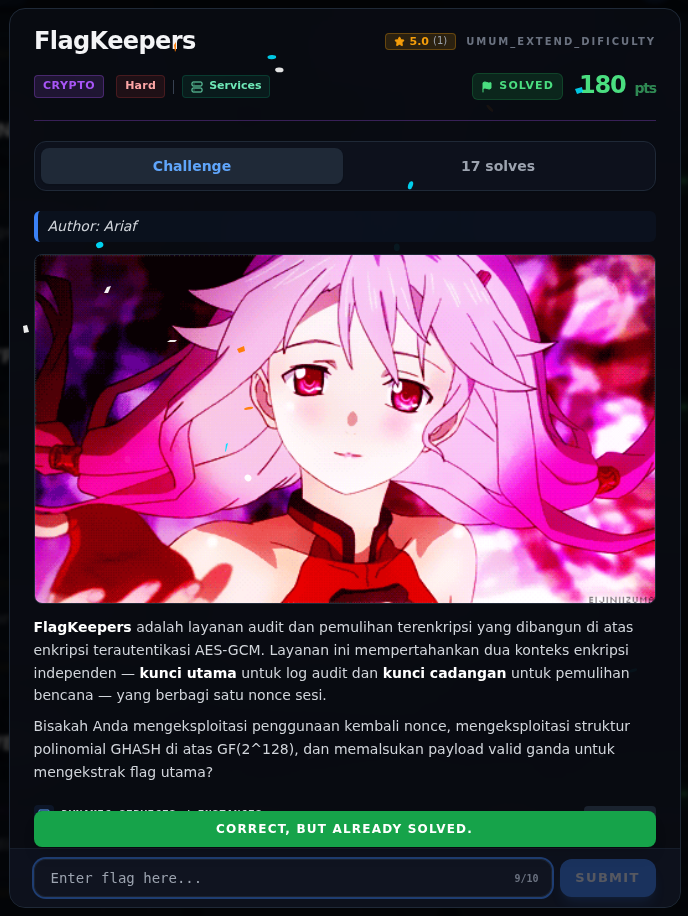

# FlagKeepers — Flag & Verifikasi

[← Overview](20-flagkeepers.md) · [Index](index.md)

> **Langkah 6/8 — Flag.** Flag
>
> **Titik penting:** NFX{gcm_f0rb1dd3n_4tt4ck_du4l_t4g_c0ll1s10n_m4st3r}
>
> **Berikutnya:** [Bukti / Evidence](20-flagkeepers-07-bukti-evidence.md)

> **Asal flag.** Flag diperoleh dari langkah exploit/solver yang terdokumentasi, lalu disubmit ke platform.  

> **Flag:** `NFX{gcm_f0rb1dd3n_4tt4ck_du4l_t4g_c0ll1s10n_m4st3r}`
> **Status:** `VERIFIED`

```text
NFX{gcm_f0rb1dd3n_4tt4ck_du4l_t4g_c0ll1s10n_m4st3r}
```

Verifikasi:

1. Live oracle (opsi `[4]`) mencetak flag di atas (`live_run.log`).
2. Platform submit log:

```json
{"time": 1794056594.031974, "id": "1d3e51f2-eebd-475b-a85b-09937d89b659",
 "title": "FlagKeepers",
 "flag": "NFX{gcm_f0rb1dd3n_4tt4ck_du4l_t4g_c0ll1s10n_m4st3r}",
 "http": 200,
 "result": {"success": true, "message": "Correct! +500 points."}}
```

### Terminal evidence (real)



*Terminal evidence (real).*

> **Bukti:** terminal evidence (real).

## Validasi platform (real)



*Screenshot asli dari platform NFX CTF 2026. Platform menjawab
`CORRECT, BUT ALREADY SOLVED.` untuk flag ini.*
