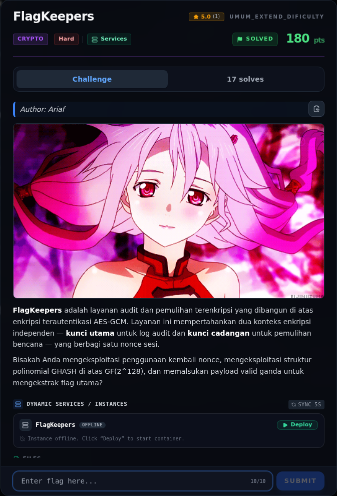
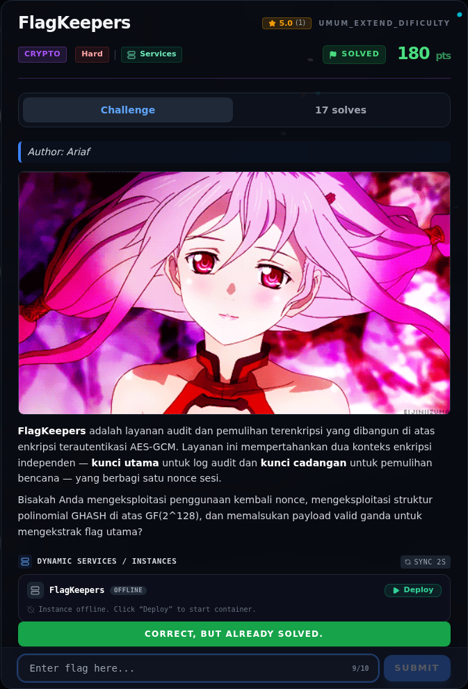
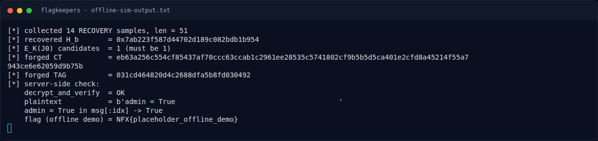

# FlagKeepers — Evidence / Bukti

3 screenshot5 transkrip / script

[← Overview](20-flagkeepers.md) · [Index](index.md)

## Arsip Evidence

> Semua file berasal dari `assets/flagkeepers/`. Screenshot platform dan terminal adalah bukti asli dari sesi solve; transkrip mentah tetap ditautkan di bagian bawah.

### Platform

<figure><figcaption>00-challenge-platform.png</figcaption></figure>

*Challenge brief asli di platform NFX CTF 2026.*

<figure><figcaption>00b-submit-platform.png</figcaption></figure>

*Submit flag di platform: `CORRECT, BUT ALREADY SOLVED.`*

### Terminal (arsip sesi)

<figure><figcaption>term-offline-sim-output.png</figcaption></figure>

*Terminal evidence — `offline-sim-output.txt` (arsip transkrip sesi solve).*

### Transkrip mentah & script

- [`exploit_live.py`](assets/flagkeepers/exploit_live.py)
- [`gcmtool.py`](assets/flagkeepers/gcmtool.py)
- [`live_run.log`](assets/flagkeepers/live_run.log)
- [`offline-sim-output.txt`](assets/flagkeepers/offline-sim-output.txt)
- [`offline_sim.py`](assets/flagkeepers/offline_sim.py)

## Tabel Evidence

| Bukti | File | Keterangan |
|---|---|---|
| Hash input | `assets/checksums-all.txt` | SHA-256 `app.py` |
| Source | `crypto/FlagKeepers/app.py` | Nonce global, logika flag |
| Helper GHASH | `assets/flagkeepers/gcmtool.py` | GF(2^128), recover H |
| Exploit live | `assets/flagkeepers/exploit_live.py` | 14 sampel + forge |
| Log live | `assets/flagkeepers/live_run.log` | H, CT/TAG forged, flag |
| Simulasi offline | `assets/flagkeepers/offline_sim.py` / `offline-sim-output.txt` | Reproduksi + verifikasi tag |
| Log submit | `work/wave2_submit_parallel.jsonl` | Flag diterima platform |