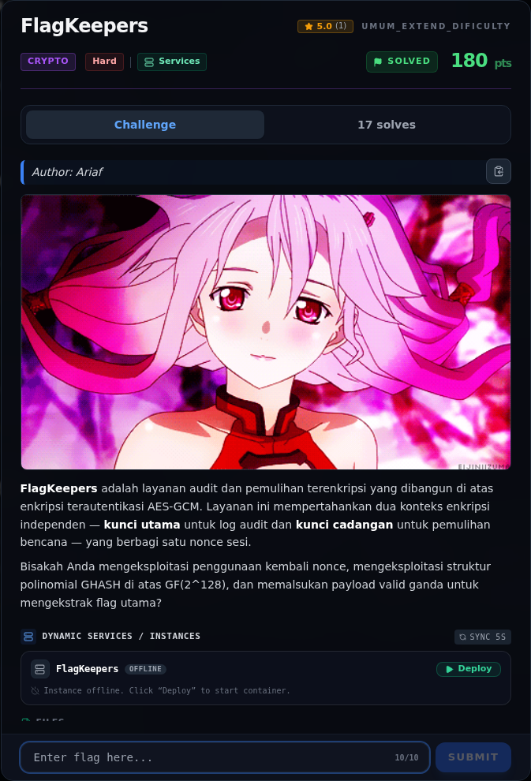
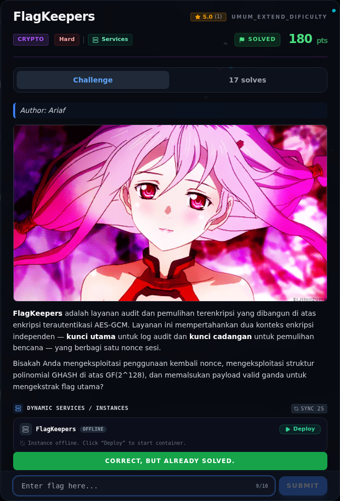

# FlagKeepers

Track Umum / Extend · CryptoHard440 poinVERIFIED

| Field | Nilai |
|---|---|
| Event | `umum_Extend` |
| Kategori | `Crypto` |
| Difficulty | `Hard` |
| Poin | `440` |
| Author | `Ariaf` |
| Solves | `4` |
| Tools | python3, sage |
| Flag | `NFX{gcm_f0rb1dd3n_4tt4ck_du4l_t4g_c0ll1s10n_m4st3r}` |
| Status | `VERIFIED` |

[← Kembali ke Index](index.md)

## Challenge Brief (platform)

*Challenge brief asli di platform NFX CTF 2026.*

## Alur & Titik Penting

| # | Langkah | Titik penting | Buka |
|---:|---|---|---|
| 1 | Recon | tcp://s1.nfx.my.id:43210 | [Buka](20-flagkeepers-01-recon.md) |
| 2 | Analisis | Untuk nonce 12 byte: | [Buka](20-flagkeepers-02-analisis.md) |
| 3 | Helper GF(2^128) / GHASH | Tersimpan di writeups/assets/flagkeepers/gcmtool.py. | [Buka](20-flagkeepers-03-helper-gf-2-128-ghash.md) |
| 4 | Solver | NFX{gcm_f0rb1dd3n_4tt4ck_du4l_t4g_c0ll1s10n_m4st3r} | [Buka](20-flagkeepers-04-solver.md) |
| 5 | Reproduksi offline | python3 offline_sim.py | [Buka](20-flagkeepers-05-reproduksi-offline.md) |
| 6 | Flag | NFX{gcm_f0rb1dd3n_4tt4ck_du4l_t4g_c0ll1s10n_m4st3r} | [Buka](20-flagkeepers-06-flag.md) |
| 7 | Bukti / Evidence | arsip screenshot dan transkrip | [Buka](20-flagkeepers-07-bukti-evidence.md) |
| 8 | Referensi | — | [Buka](20-flagkeepers-08-referensi.md) |

## TL;DR

- `app.py` memakai **satu nonce GCM global** untuk dua key berbeda
  (`key_a` untuk AUDIT, `key_b` untuk RECOVERY).
- Opsi `[2]` mencetak plaintext RECOVERY secara verbatim, sehingga keystream
  CTR untuk `key_b` dapat dihitung: `KS = CT XOR PT`.
- Semua pesan RECOVERY panjangnya sama (51 byte = 4 blok), jadi blok panjang
  GHASH saling menghilangkan pada selisih tag.
- Selisih tag menjadi sistem linear atas monomial `H²..H⁵` di GF(2¹²⁸);
  selesaikan untuk `H = AES_{key_b}(0^128)`. Setelah `H` diketahui,
  `E_{key_b}(J0) = tag XOR GHASH(H,CT)` konsisten di semua sampel.
- Forge plaintext `admin = True` + 39 spasi, hitung CT dan TAG, kirim ke
  opsi `[4]`. Setelah 14 kali opsi `[2]`, `idx = 32`, sehingga
  `msg[:idx]` memuat `admin = True`.
- Flag: `NFX{gcm_f0rb1dd3n_4tt4ck_du4l_t4g_c0ll1s10n_m4st3r}`.

Pratinjau evidence. Buka halaman <a href="20-flagkeepers-07-bukti-evidence.html">Evidence / Bukti</a> untuk semua screenshot dan transkrip.

## Navigasi Halaman

<a class="nx-page-card" href="20-flagkeepers-01-recon.html"><b>Recon</b>Enumerasi target dan bukti awal</a>
<a class="nx-page-card" href="20-flagkeepers-02-analisis.html"><b>Analisis</b>Membaca alur dan akar masalah</a>
<a class="nx-page-card" href="20-flagkeepers-03-helper-gf-2-128-ghash.html"><b>Helper GF(2^128) / GHASH</b>Baca bagian ini</a>
<a class="nx-page-card" href="20-flagkeepers-04-solver.html"><b>Solver</b>Langkah exploit dan solver</a>
<a class="nx-page-card" href="20-flagkeepers-05-reproduksi-offline.html"><b>Reproduksi offline</b>Baca bagian ini</a>
<a class="nx-page-card" href="20-flagkeepers-06-flag.html"><b>Flag</b>Flag dan verifikasi platform</a>
<a class="nx-page-card" href="20-flagkeepers-07-bukti-evidence.html"><b>Bukti / Evidence</b>Screenshot, transkrip, dan artefak</a>
<a class="nx-page-card" href="20-flagkeepers-08-referensi.html"><b>Referensi</b>Sumber dan bacaan lanjutan</a>

