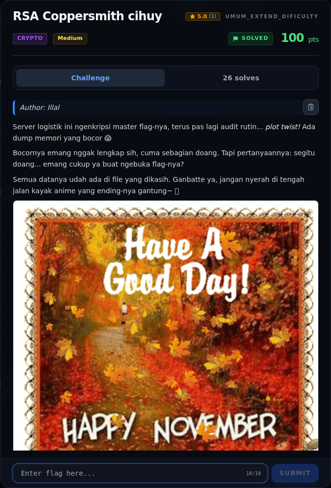

# RSA Coppersmith cihuy — Recon

[← Overview](21-rsa-coppersmith-cihuy.md) · [Index](index.md)

> **Langkah 1/7 — Recon.** Isi chall.py hanya konstanta:
>
> **Titik penting:** Isi chall.py hanya konstanta:
>
> **Berikutnya:** [Analisis](21-rsa-coppersmith-cihuy-02-analisis.md)

### 1.1 Deskripsi challenge

> Author: Illal
>
> Server logistik ini ngenkripsi master flag-nya, terus pas lagi audit
> rutin... *plot twist!* Ada dump memori yang bocor 😱
>
> Bocornya emang nggak lengkap sih, cuma sebagian doang. Tapi pertanyaannya:
> segitu doang... emang cukup ya buat ngebuka flag-nya?
>
> Semua datanya udah ada di file yang dikasih.

### 1.2 File yang diberikan

| File | Ukuran | SHA-256 |
|---|---:|---|
| `chall.py` | 674 byte | `be1635552e0b4fd1d83259896b5dee6498d7bbd944c82d0292c1b0fc32d33cf1` |

Isi `chall.py` hanya konstanta:

```python
n = 0xE4ABA2D6...7421B
e = 65537
c = 0xC5DD7E48...06174
p_msb = 0xF1322878...1CA3
p_msb_bits = 300
unknown_bits = 212
```

### 1.3 Environment

- Python 3.12
- `fpylll` (LLL)
- `sympy` (Poly, roots)
- Tidak perlu Sage.

### 1.4 Triage awal

```python
>>> n.bit_length(), e, p_msb_bits, unknown_bits
(1024, 65537, 300, 212)
>>> p_msb.bit_length()
300
```

`300 + 212 = 512`, jadi `p` adalah prima 512-bit dan `N` adalah produk dua
prima 512-bit (RSA-1024).

### Evidence langkah ini



*Challenge brief asli di platform NFX CTF 2026.*
