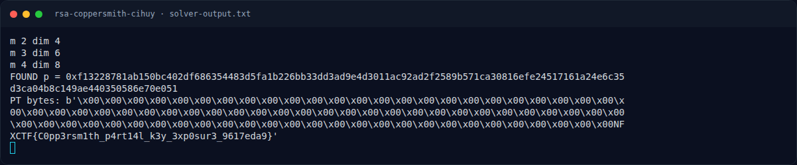
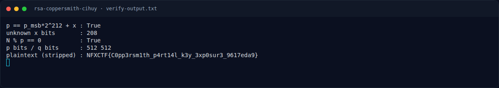

# RSA Coppersmith cihuy — Script lengkap

[← Overview](21-rsa-coppersmith-cihuy.md) · [Index](index.md)

> **Langkah 3/7 — Script lengkap.** Tersimpan di docs/assets/rsa-coppersmith-cihuy/solve.py:
>
> **Titik penting:** Tersimpan di docs/assets/rsa-coppersmith-cihuy/solve.py:
>
> **Berikutnya:** [Solver](21-rsa-coppersmith-cihuy-04-solver.md)

## 3.1 Script lengkap

Tersimpan di `docs/assets/rsa-coppersmith-cihuy/solve.py`:

```python
#!/usr/bin/env python3
from sympy import Poly, symbols
from fpylll import IntegerMatrix, LLL

n = 0xE4ABA2D625FEC44D3984056BED4ED632B178E6F5B3893593E736111E9E91A7130F957FD76C48D42724C3423F6D6D8132EF909A8E414E24F6ACE3BA2C0A8059C29BCE292055A9BF9B7008E0788162B568691E85F52C24A9D904DDFFC6EF5DCB177D12243CFE449AB3638E52491247455C1DF12030975D469A933685CF0527421B
e = 65537
c = 0xC5DD7E48FF77FBC1D1AD1130550CDE5FDEC27CDF2D8A890370DEFA7605538EA82945462297449AB9D0F8C01D0FF403283F0B4DA677389289F0D923FE6E24DD6B3AFA02F22534754C0261C87EC7C0E488DC2A764DD327A1EA211AD1025EB231B7E856F4F66333A9FFC3A16189C47E4DE39D55C9ED474AEEAF4F22B997EC706174
p_msb = 0xF13228781AB150BC402DF686354483D5FA1B226BB33DD3AD9E4D3011AC92AD2F2589B571CA3
ubits = 212
X = 1 << (ubits + 1)
a = p_msb << ubits

def polymul(p, q):
    r = [0] * (len(p) + len(q) - 1)
    for i, x in enumerate(p):
        for j, y in enumerate(q):
            r[i + j] += x * y
    return r

def polypow(p, k):
    r = [1]
    for _ in range(k):
        r = polymul(r, p)
    return r

f = [a, 1]
x = symbols("x")

def try_poly(coeffs, dim):
    poly = sum(coeffs[k] * x**k for k in range(dim))
    P = Poly(poly, x)
    roots = []
    try:
        for r0, mult in P.ground_roots().items():
            roots.append(int(r0))
    except Exception:
        pass
    try:
        for r0 in P.nroots(n=40):
            if abs(r0.as_real_imag()[1]) < 1e-15:
                rr = r0.as_real_imag()[0]
                if abs(rr - round(rr)) < 1e-15:
                    roots.append(int(round(rr)))
    except Exception:
        pass
    for cand in roots:
        for cc in (cand, cand % n):
            if not (0 <= cc < X):
                continue
            p = a + cc
            if 1 < p < n and n % p == 0:
                return p
    return None

for m in range(2, 9):
    t = m
    polys = []
    for i in range(m):
        g = [coef * pow(n, m - i) for coef in polypow(f, i)]
        polys.append(g)
    fm = polypow(f, m)
    for j in range(t):
        polys.append([0] * j + fm)
    dim = len(polys)
    M = IntegerMatrix(dim, dim)
    for r in range(dim):
        g = polys[r]
        for k, coef in enumerate(g):
            M[r, k] = coef * pow(X, k)
    LLL.reduction(M)
    print("m", m, "dim", dim)
    for r in range(dim):
        row = [M[r, k] for k in range(dim)]
        if any(row[k] % pow(X, k) for k in range(dim)):
            continue
        coeffs = [row[k] // pow(X, k) for k in range(dim)]
        p = try_poly(coeffs, dim)
        if p:
            print("FOUND p =", hex(p))
            q = n // p
            d = pow(e, -1, (p - 1) * (q - 1))
            pt = pow(c, d, n).to_bytes((n.bit_length() + 7) // 8, "big")
            print("PT bytes:", pt)
            raise SystemExit
print("not found")
```

### Evidence langkah ini



*Terminal evidence — `solver-output.txt` (arsip transkrip sesi solve).*



*Terminal evidence — `verify-output.txt` (arsip transkrip sesi solve).*

**Berkas mentah langkah ini:**

- [`solver-output.txt`](assets/rsa-coppersmith-cihuy/solver-output.txt)
- [`verify-output.txt`](assets/rsa-coppersmith-cihuy/verify-output.txt)
