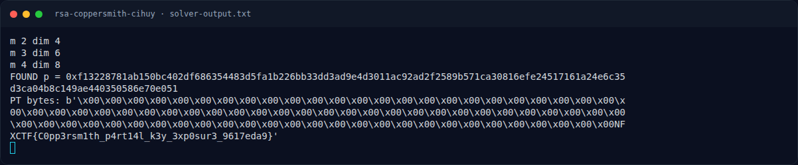
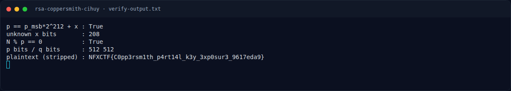

# RSA Coppersmith cihuy — Solver

[← Overview](21-rsa-coppersmith-cihuy.md) · [Index](index.md)

> **Langkah 4/7 — Solver.** Script docs/assets/rsa-coppersmith-cihuy/verify.py mengecek ulang:
>
> **Titik penting:** python3 docs/assets/rsa-coppersmith-cihuy/solve.py · python3 verify.py · NFXCTF{C0pp3rsm1th_p4rt14l_k3y_3xp0sur3_9617eda9}
>
> **Berikutnya:** [Flag](21-rsa-coppersmith-cihuy-05-flag.md)

## 3.2 Output asli

```text
$ python3 docs/assets/rsa-coppersmith-cihuy/solve.py
m 2 dim 4
m 3 dim 6
m 4 dim 8
FOUND p = 0xf13228781ab150bc402df686354483d5fa1b226bb33dd3ad9e4d3011ac92ad2f2589b571ca30816efe24517161a24e6c35d3ca04b8c149ae440350586e70e051
PT bytes: b'\x00\x00\x00\x00\x00\x00\x00\x00\x00\x00\x00\x00\x00\x00\x00\x00\x00\x00\x00\x00\x00\x00\x00\x00\x00\x00\x00\x00\x00\x00\x00\x00\x00\x00\x00\x00\x00\x00\x00\x00\x00\x00\x00\x00\x00\x00\x00\x00\x00\x00\x00\x00\x00\x00\x00\x00\x00\x00\x00\x00\x00\x00\x00\x00\x00\x00\x00\x00\x00\x00\x00\x00\x00\x00\x00\x00\x00\x00\x00NFXCTF{C0pp3rsm1th_p4rt14l_k3y_3xp0sur3_9617eda9}'
```

## 3.3 Verifikasi

Script `docs/assets/rsa-coppersmith-cihuy/verify.py` mengecek ulang:

```text
$ python3 verify.py
p == p_msb*2^212 + x : True
unknown x bits       : 208
N % p == 0           : True
p bits / q bits      : 512 512
plaintext (stripped) : NFXCTF{C0pp3rsm1th_p4rt14l_k3y_3xp0sur3_9617eda9}
```

`unknown x bits = 208` berarti dari 212 bit yang tidak diketahui, 208 bit
benar-benar terpakai; empat bit teratas `x` nol. Ini tetap di bawah batas
`N^{0.25}`.

### Evidence langkah ini



*Terminal evidence — `solver-output.txt` (arsip transkrip sesi solve).*



*Terminal evidence — `verify-output.txt` (arsip transkrip sesi solve).*

**Berkas mentah langkah ini:**

- [`solver-output.txt`](assets/rsa-coppersmith-cihuy/solver-output.txt)
- [`verify-output.txt`](assets/rsa-coppersmith-cihuy/verify-output.txt)
