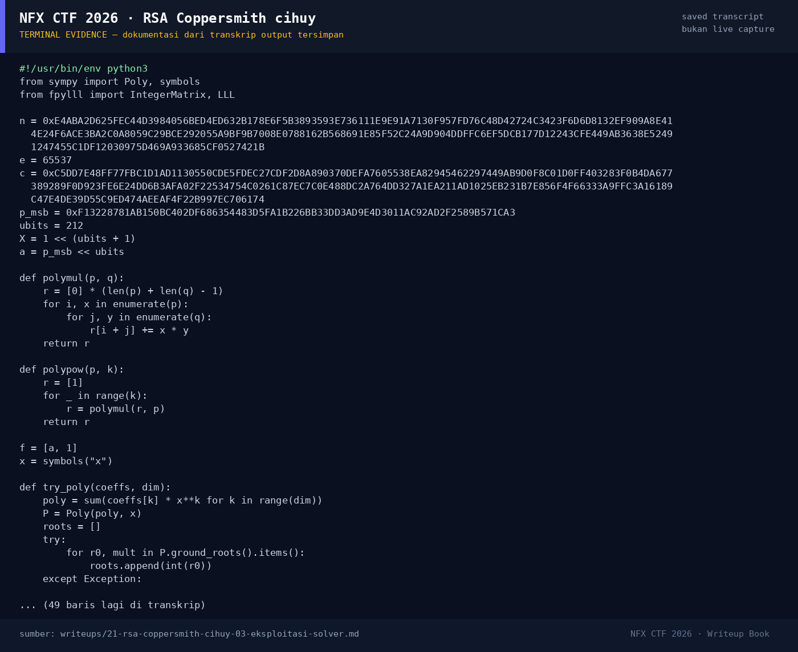

# RSA Coppersmith cihuy — Evidence / Bukti

1 screenshot4 transkrip / script

[← Overview](21-rsa-coppersmith-cihuy.md) · [Index](index.md)

## Arsip Evidence

> Semua file di bawah berasal dari folder `assets/rsa-coppersmith-cihuy/`. Screenshot ditempel langsung; file teks/script ditautkan.

### Screenshot

<figure><figcaption>98-terminal-evidence.png</figcaption></figure>

### Transkrip / file pendukung

- [`solve.py`](assets/rsa-coppersmith-cihuy/solve.py)
- [`solver-output.txt`](assets/rsa-coppersmith-cihuy/solver-output.txt)
- [`verify-output.txt`](assets/rsa-coppersmith-cihuy/verify-output.txt)
- [`verify.py`](assets/rsa-coppersmith-cihuy/verify.py)

## Tabel Evidence

| Bukti | File | Keterangan |
|---|---|---|
| Hash input | `assets/checksums-all.txt` | SHA-256 `chall.py` |
| Solver | `assets/rsa-coppersmith-cihuy/solve.py` | Coppersmith m=4 |
| Output solver | `assets/rsa-coppersmith-cihuy/solver-output.txt` | `p`, plaintext |
| Verifikasi | `assets/rsa-coppersmith-cihuy/verify.py` / `verify-output.txt` | `N % p == 0`, flag |
| Log submit | `work/wave2_submit_parallel.jsonl` | Flag diterima platform |