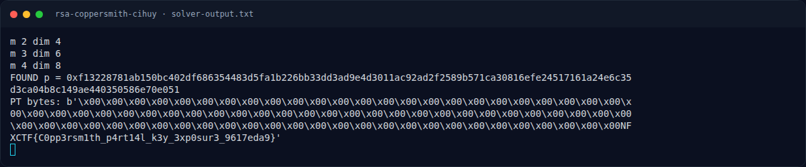
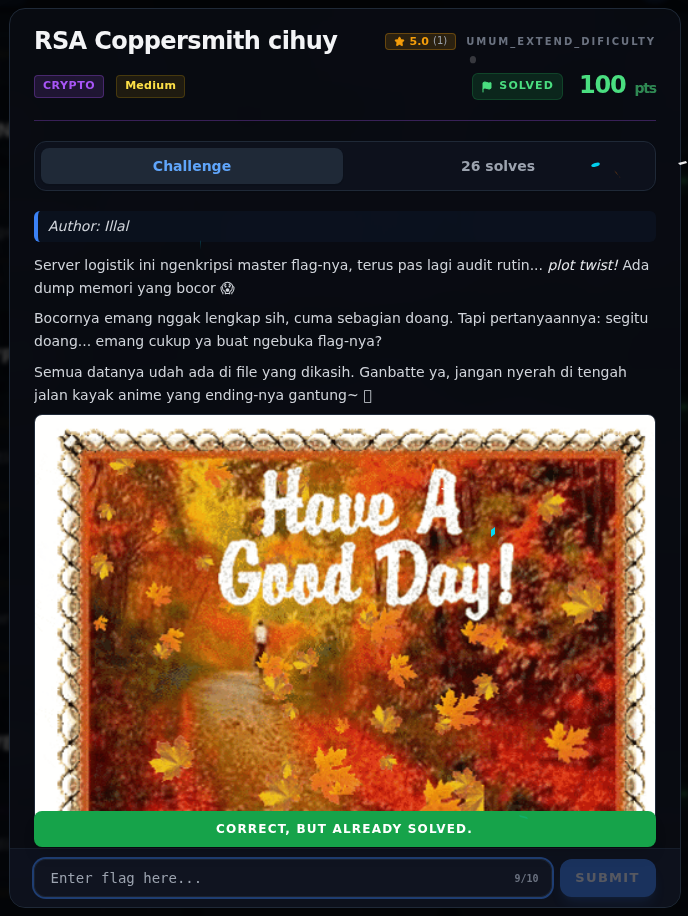

# RSA Coppersmith cihuy — Flag & Verifikasi

[← Overview](21-rsa-coppersmith-cihuy.md) · [Index](index.md)

> **Langkah 5/7 — Flag.** Verifikasi (log submit asli):
>
> **Titik penting:** NFXCTF{C0pp3rsm1th_p4rt14l_k3y_3xp0sur3_9617eda9}
>
> **Berikutnya:** [Bukti / Evidence](21-rsa-coppersmith-cihuy-06-bukti-evidence.md)

> **Asal flag.** Flag diperoleh dari langkah exploit/solver yang terdokumentasi, lalu disubmit ke platform.  
> **Tingkat bukti metode.** Terdokumentasi. [Buka Evidence](21-rsa-coppersmith-cihuy-06-bukti-evidence.md)

> **Status metode:** **FULL** — metode utama berhasil direproduksi.  
> **Flag:** `NFXCTF{C0pp3rsm1th_p4rt14l_k3y_3xp0sur3_9617eda9}`
> **Status:** `VERIFIED`

```text
NFXCTF{C0pp3rsm1th_p4rt14l_k3y_3xp0sur3_9617eda9}
```

Verifikasi (log submit asli):

```json
{"time": 1794056594.417421, "id": "86f25c60-04b5-4885-bae4-a1b843c849ac",
 "title": "RSA Coppersmith cihuy",
 "flag": "NFXCTF{C0pp3rsm1th_p4rt14l_k3y_3xp0sur3_9617eda9}",
 "http": 200,
 "result": {"success": true, "message": "Correct! +500 points."}}
```

### Terminal evidence (real)



*Terminal evidence (real).*

> **Bukti:** terminal evidence (real).

## Validasi platform (real)



*Screenshot asli dari platform NFX CTF 2026. Platform menjawab
`CORRECT, BUT ALREADY SOLVED.` untuk flag ini.*
