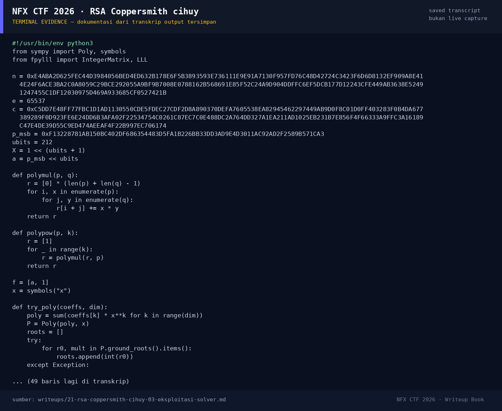

# RSA Coppersmith cihuy

Track Umum / Extend · CryptoMedium120 poinVERIFIED

| Field | Nilai |
|---|---|
| Event | `umum_Extend` |
| Kategori | `Crypto` |
| Difficulty | `Medium` |
| Poin | `120` |
| Author | `Illal` |
| Solves | `20` |
| Tools | python3, sage, fpylll, git |
| Flag | `NFXCTF{C0pp3rsm1th_p4rt14l_k3y_3xp0sur3_9617eda9}` |
| Status | `VERIFIED` |

[← Kembali ke Index](index.md)

## TL;DR

- RSA 1024-bit dengan `e=65537`; hanya `chall.py` yang diberikan.
- 300 bit atas dari faktor `p` bocor (`p_msb`), 212 bit bawah tidak diketahui.
- Ini **partial key exposure**: `p = p_msb·2^212 + x`, `|x| < 2^212`.
- Coppersmith univariate (`f(x) = a + x mod N`) dengan lattice
  Howgrave-Graham dan LLL menemukan `x`, sehingga `p` dan `q` didapat.
- Dekripsi RSA memberi plaintext yang di-zero-pad di kiri:
  `NFXCTF{C0pp3rsm1th_p4rt14l_k3y_3xp0sur3_9617eda9}`.

Pratinjau evidence. Buka halaman <a href="21-rsa-coppersmith-cihuy-05-bukti-evidence.html">Evidence / Bukti</a> untuk semua screenshot dan transkrip.

## Navigasi Halaman

<a class="nx-page-card" href="21-rsa-coppersmith-cihuy-01-recon.html"><b>Recon</b>Enumerasi target dan bukti awal</a>
<a class="nx-page-card" href="21-rsa-coppersmith-cihuy-02-analisis.html"><b>Analisis</b>Membaca alur dan akar masalah</a>
<a class="nx-page-card" href="21-rsa-coppersmith-cihuy-03-eksploitasi-solver.html"><b>Eksploitasi / Solver</b>Langkah exploit dan solver</a>
<a class="nx-page-card" href="21-rsa-coppersmith-cihuy-04-flag.html"><b>Flag</b>Flag dan verifikasi platform</a>
<a class="nx-page-card" href="21-rsa-coppersmith-cihuy-05-bukti-evidence.html"><b>Bukti / Evidence</b>Screenshot, transkrip, dan artefak</a>
<a class="nx-page-card" href="21-rsa-coppersmith-cihuy-06-referensi.html"><b>Referensi</b>Sumber dan bacaan lanjutan</a>

