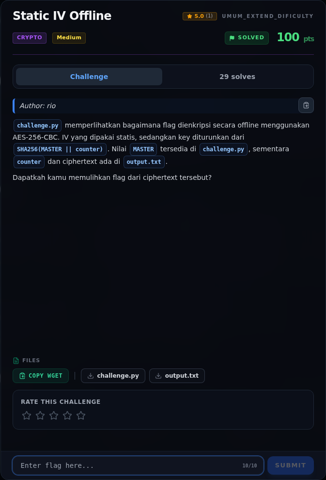

# Static IV Offline — Analisis

[← Overview](22-static-iv-offline.md) · [Index](index.md)

> **Langkah 3/7 — Analisis.** Dengan IV statis dan key yang sama, dua plaintext yang berbeda tetapi berbagi blok pertama yang sama akan menghasilkan blok ciphertext pertama yang sama.
>
> **Titik penting:** Dengan IV statis dan key yang sama, dua plaintext yang berbeda tetapi berbagi blok pertama yang sama akan menghasilkan blok ciphertext pertama yang sama.
>
> **Berikutnya:** [Solver](22-static-iv-offline-04-solver.md)

### 2.1 Key derivation

```text
MASTER = 0x13 0x37 0x13 0x37 ... (32 byte)
counter = 11 = 0x0b000000 (little-endian 4 byte)
key = SHA256(MASTER || 0b 00 00 00)[:32]
```

Key aktual:

```text
c3bde56fc541212d2e6a51ce58b7c3cb9330284ad45b5ea1c476296b70ef2fed
```

### 2.2 Mengapa "static IV" berbahaya di sini

Pada CBC:

```text
C_1 = E_K(P_1 XOR IV)
C_i = E_K(P_i XOR C_{i-1})
```

Dengan IV statis dan key yang sama, dua plaintext yang berbeda tetapi
berbagi blok pertama yang sama akan menghasilkan blok ciphertext pertama
yang sama. Itu membocorkan kesamaan prefix. Namun pada challenge ini, static
IV bukan satu-satunya bug: `MASTER` sendiri bocor di source, sehingga key
bisa dihitung langsung. IV statis hanya memperkuat kesan "offline reuse" yang
disebut di judul.

### 2.3 Struktur plaintext

Fungsi enkripsi selalu menyisipkan:

```text
PREFIX + b"|" + flag = b"user-input-goes-here:|" + flag
```

Setelah dekripsi dan `unpad`, flag diambil dengan `split(b"|", 1)[1]`.

### Evidence langkah ini



*Challenge brief asli di platform NFX CTF 2026.*
