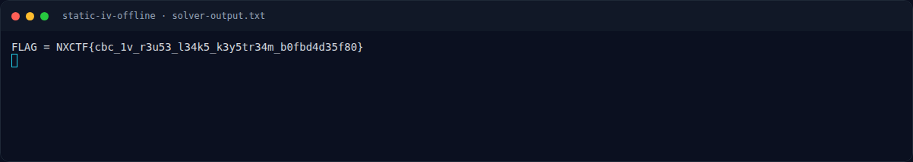
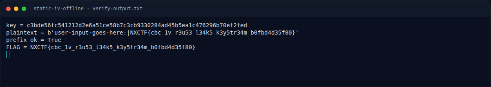

# Static IV Offline — Solver

[← Overview](22-static-iv-offline.md) · [Index](index.md)

> **Langkah 4/7 — Solver.** Tersimpan di writeups/assets/static-iv-offline/solve.py (sama dengan crypto/StaticIVOffline/solve.py):
>
> **Titik penting:** python3 solve.py · python3 verify.py · cd crypto/Static_IV_Offline
>
> **Berikutnya:** [Flag](22-static-iv-offline-05-flag.md)

### 3.1 Script lengkap

Tersimpan di `writeups/assets/static-iv-offline/solve.py` (sama dengan
`crypto/Static_IV_Offline/solve.py`):

```python
import hashlib, json
from Crypto.Cipher import AES
from Crypto.Util.Padding import unpad

MASTER = b"\x13\x37" * 16
d = json.load(open("output.txt"))
ct = bytes.fromhex(d["ct_hex"])
iv = bytes.fromhex(d["iv_hex"])
counter = d["counter"]

key = hashlib.sha256(MASTER + counter.to_bytes(4, "little")).digest()[:32]
pt = unpad(AES.new(key, AES.MODE_CBC, iv).decrypt(ct), 16)
assert b"|" in pt
flag = pt.split(b"|", 1)[1].decode()
print("FLAG =", flag)
```

### 3.2 Output asli

```text
$ cd crypto/Static_IV_Offline
$ python3 solve.py
FLAG = NXCTF{cbc_1v_r3u53_l34k5_k3y5tr34m_b0fbd4d35f80}
```

Verifikasi tambahan (key, plaintext utuh, prefix):

```text
$ python3 verify.py
key = c3bde56fc541212d2e6a51ce58b7c3cb9330284ad45b5ea1c476296b70ef2fed
plaintext = b'user-input-goes-here:|NXCTF{cbc_1v_r3u53_l34k5_k3y5tr34m_b0fbd4d35f80}'
prefix ok = True
FLAG = NXCTF{cbc_1v_r3u53_l34k5_k3y5tr34m_b0fbd4d35f80}
```

### Evidence langkah ini



*Terminal evidence — `solver-output.txt` (arsip transkrip sesi solve).*



*Terminal evidence — `verify-output.txt` (arsip transkrip sesi solve).*

**Berkas mentah langkah ini:**

- [`solver-output.txt`](assets/static-iv-offline/solver-output.txt)
- [`verify-output.txt`](assets/static-iv-offline/verify-output.txt)
