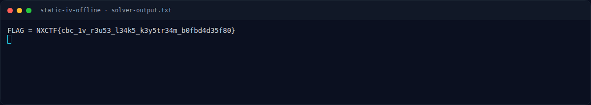
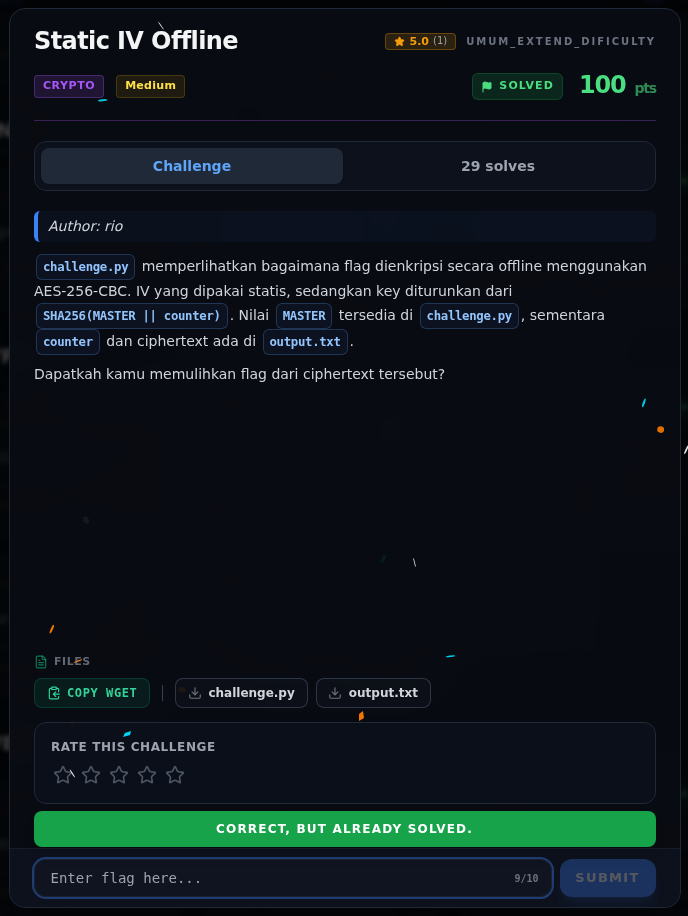

# Static IV Offline — Flag & Verifikasi

[← Overview](22-static-iv-offline.md) · [Index](index.md)

> **Langkah 5/7 — Flag.** Verifikasi (log submit asli):
>
> **Titik penting:** NXCTF{cbc_1v_r3u53_l34k5_k3y5tr34m_b0fbd4d35f80}
>
> **Berikutnya:** [Bukti / Evidence](22-static-iv-offline-06-bukti-evidence.md)

> **Asal flag.** Flag diperoleh dari langkah exploit/solver yang terdokumentasi, lalu disubmit ke platform.  
> **Tingkat bukti metode.** Terdokumentasi. [Buka Evidence](22-static-iv-offline-06-bukti-evidence.md)

> **Flag:** `NXCTF{cbc_1v_r3u53_l34k5_k3y5tr34m_b0fbd4d35f80}`
> **Status:** `VERIFIED`

```text
NXCTF{cbc_1v_r3u53_l34k5_k3y5tr34m_b0fbd4d35f80}
```

Verifikasi (log submit asli):

```json
{"time": 1794056594.4067898, "id": "2b3a7192-c820-4a14-b6ba-89738fd88254",
 "title": "Static IV Offline",
 "flag": "NXCTF{cbc_1v_r3u53_l34k5_k3y5tr34m_b0fbd4d35f80}",
 "http": 200,
 "result": {"success": true, "message": "Correct! +500 points."}}
```

### Terminal evidence (real)



*Terminal evidence (real).*

> **Bukti:** terminal evidence (real).

## Validasi platform (real)



*Screenshot asli dari platform NFX CTF 2026. Platform menjawab
`CORRECT, BUT ALREADY SOLVED.` untuk flag ini.*
