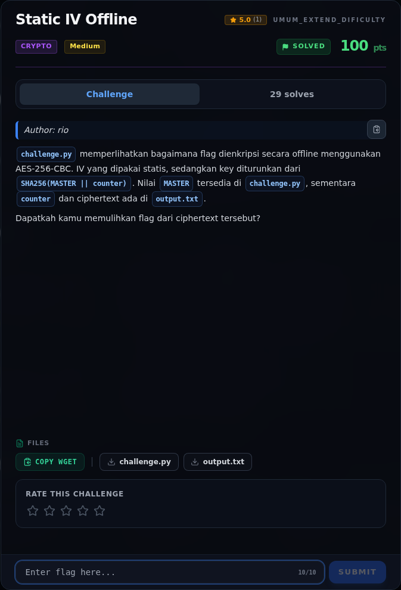

# Static IV Offline — Referensi

[← Overview](22-static-iv-offline.md) · [Index](index.md)

> **Langkah 7/7 — Referensi.** Referensi
>
> **Titik penting:** —
>
> **Selesai.** Kembali ke [Overview](22-static-iv-offline.md).

- NIST SP 800-38A — CBC mode.
- PKCS#7 padding (RFC 5652).
- OWASP Cryptographic Storage Cheat Sheet.

### Evidence langkah ini

*Challenge brief asli di platform NFX CTF 2026.*
