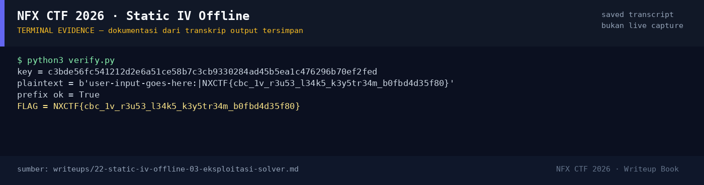

# Static IV Offline

Track Umum / Extend · CryptoMedium140 poinVERIFIED

| Field | Nilai |
|---|---|
| Event | `umum_Extend` |
| Kategori | `Crypto` |
| Difficulty | `Medium` |
| Poin | `140` |
| Author | `rio` |
| Solves | `19` |
| Tools | python3, sage |
| Flag | `NXCTF{cbc_1v_r3u53_l34k5_k3y5tr34m_b0fbd4d35f80}` |
| Status | `VERIFIED` |

[← Kembali ke Index](index.md)

## TL;DR

- `challenge.py` membocorkan `MASTER = b"\x13\x37" * 16` di source.
- Key AES-256-CBC diturunkan sebagai
  `SHA256(MASTER || counter.to_bytes(4, "little"))[:32]`.
- `output.txt` memberi `counter=11`, IV statis `aa...aa`, dan ciphertext.
- Karena semua bahan key tersedia, dekripsi langsung berhasil; plaintext
  berisi prefix `user-input-goes-here:|` diikuti flag.
- Flag: `NXCTF{cbc_1v_r3u53_l34k5_k3y5tr34m_b0fbd4d35f80}`.

Pratinjau evidence. Buka halaman <a href="22-static-iv-offline-05-bukti-evidence.html">Evidence / Bukti</a> untuk semua screenshot dan transkrip.

## Navigasi Halaman

<a class="nx-page-card" href="22-static-iv-offline-01-recon.html"><b>Recon</b>Enumerasi target dan bukti awal</a>
<a class="nx-page-card" href="22-static-iv-offline-02-analisis.html"><b>Analisis</b>Membaca alur dan akar masalah</a>
<a class="nx-page-card" href="22-static-iv-offline-03-eksploitasi-solver.html"><b>Eksploitasi / Solver</b>Langkah exploit dan solver</a>
<a class="nx-page-card" href="22-static-iv-offline-04-flag.html"><b>Flag</b>Flag dan verifikasi platform</a>
<a class="nx-page-card" href="22-static-iv-offline-05-bukti-evidence.html"><b>Bukti / Evidence</b>Screenshot, transkrip, dan artefak</a>
<a class="nx-page-card" href="22-static-iv-offline-06-referensi.html"><b>Referensi</b>Sumber dan bacaan lanjutan</a>

