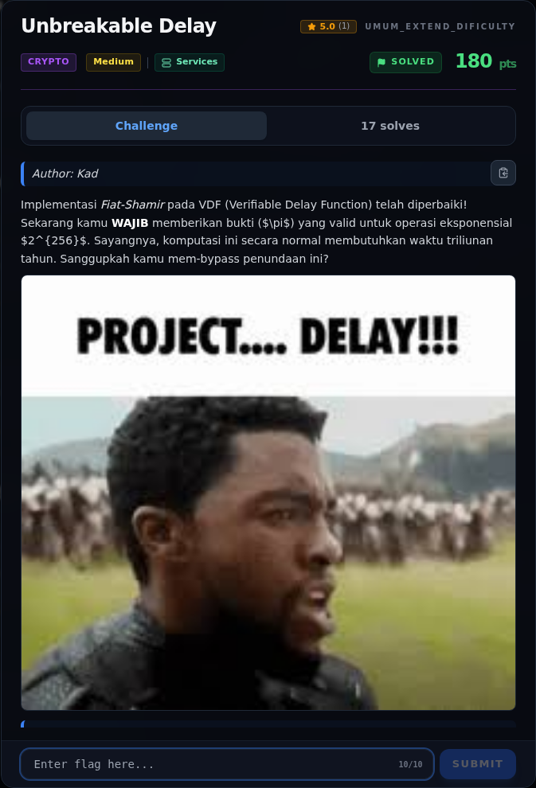

# Unbreakable Delay — Recon

[← Overview](23-unbreakable-delay.md) · [Index](index.md)

> **Langkah 1/8 — Recon.** Tidak ada source server.py, vdf.py, atau output instance.
>
> **Titik penting:** timeout 5 bash -c 'echo \| nc -v s1.nfx.my.id 43206' · cat flags/misc/UnbreakableDelay.txt · NFX{your_flag_here}
>
> **Berikutnya:** [Analisis](23-unbreakable-delay-02-analisis.md)

### 1.1 Deskripsi challenge

> Author: Kad
>
> Implementasi *Fiat-Shamir* pada VDF (Verifiable Delay Function) telah
> diperbaiki! Sekarang kamu **WAJIB** memberikan bukti ($\pi$) yang valid
> untuk operasi eksponensial $2^{256}$. Sayangnya, komputasi ini secara
> normal membutuhkan waktu triliunan tahun. Sanggupkah kamu mem-bypass
> penundaan ini?
>
> Format: `NFX{your_flag_here}`

### 1.2 File / service

| Item | Nilai |
|---|---|
| Attachment | tidak ada di workspace |
| Service historis | `tcp://s1.nfx.my.id:43206` (work/ENDPOINTS.md), port 1337 di inventaris |
| Status saat writeup | connection refused |
| Flag | `flags/misc/UnbreakableDelay.txt` |

Tidak ada source `server.py`, `vdf.py`, atau output instance. Semua analisis
protokol di bawah adalah rekonstruksi dari deskripsi + nama flag.

### 1.3 Environment

- Python 3.x (integer arbitrary precision)
- Untuk instance asli: cukup Python + `sympy.nextprime`/`isprime` jika perlu
- Tidak perlu Sage

### 1.4 Triage

```bash
$ timeout 5 bash -c 'echo | nc -v s1.nfx.my.id 43206'
nc: connect to s1.nfx.my.id (116.212.75.209) port 43206 (tcp) failed: Connection refused
```

```bash
$ cat flags/misc/UnbreakableDelay.txt
NFX{x0r_f4ct0r1ng_4nd_f4st_vdf_byp4ss_m4k3s_1t_h4rd}
```

Nama flag adalah hint serangan: **XOR factoring** dan **fast VDF bypass**.

### Evidence langkah ini



*Challenge brief asli di platform NFX CTF 2026.*
