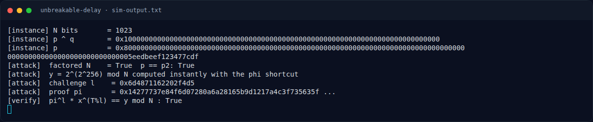

# Unbreakable Delay — Analisis

[← Overview](23-unbreakable-delay.md) · [Index](index.md)

> **Langkah 3/8 — Analisis.** Setelah p,q diketahui:
>
> **Titik penting:** Setelah p,q diketahui:
>
> **Berikutnya:** [Solver](23-unbreakable-delay-04-solver.md)

## 2.4 Bug: `φ(N)` membunuh delay

Setelah `p,q` diketahui:

```text
φ(N) = (p-1)(q-1)
```

Karena `gcd(2,N)=1`, eksponen raksasa dapat direduksi:

```text
2^T mod N = 2^(T mod φ(N)) mod N
```

Jadi `y` dapat dihitung tanpa `T` squaring:

```text
e = pow(2, 256, φ(N))       # 2^256 mod φ(N)
y = pow(2, e, N)
```

Proof juga dapat dihitung cepat:

```text
π = pow(2, (T // l) mod φ(N), N)
```

Verifikasi tetap lolos karena semua eksponen bekerja modulo `φ(N)`.

## 2.5 Mengapa ini "fast VDF bypass"

VDF mengasumsikan prover tidak tahu orde grup. Begitu `φ(N)` diketahui,
seluruh "delay" hilang: baik evaluasi `y` maupun pembuatan `π` menjadi
beberapa eksponensial modular biasa. Ini bukan sekadar speedup — ini
menghancurkan properti **sequentiality** yang menjadi definisi VDF.

### Evidence langkah ini



*Terminal evidence — transkrip langkah — `term-sim-output.png`.*

**Berkas mentah terkait:**

- [`sim-output.txt`](assets/unbreakable-delay/sim-output.txt)
