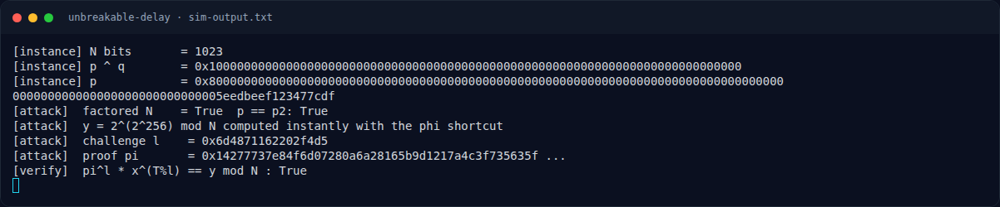

# Unbreakable Delay — Solver

[← Overview](23-unbreakable-delay.md) · [Index](index.md)

> **Langkah 4/8 — Solver.** Karena instance asli tidak tersedia, dibuat instance sintetis dengan p XOR q = 2^300 untuk mendemonstrasikan seluruh matematika.
>
> **Titik penting:** Karena instance asli tidak tersedia, dibuat instance sintetis dengan p XOR q = 2^300 untuk mendemonstrasikan seluruh matematika.
>
> **Berikutnya:** [Output asli simulasi](23-unbreakable-delay-05-output-asli-simulasi.md)

## 3.1 Strategi **[REKONSTRUKSI]**

1. Terima `N` dari service (dan `x=2`, `T=2^256`).
2. Faktorkan `N` dengan memanfaatkan relasi XOR `p XOR q = K`.
   - Jika `K=2^k`: selesaikan kuadrat dari `δ=±2^k`.
   - Jika `K` kecil: enumerasi kandidat `δ` / gunakan Fermat.
3. Hitung `φ(N)`.
4. Hitung `y = pow(2, pow(2,256,φ(N)), N)`.
5. Hitung challenge `l = H(x,y)` sesuai protokol.
6. Hitung `π = pow(2, (T // l) % φ(N), N)`.
7. Kirim `(y, π)`; verifier memeriksa
   `pow(π,l,N) * pow(2, T % l, N) % N == y`.

## 3.2 Demo solver (SIMULASI)

Karena instance asli tidak tersedia, dibuat instance sintetis dengan
`p XOR q = 2^300` untuk mendemonstrasikan seluruh matematika. Script:
`docs/assets/unbreakable-delay/sim_vdf.py`.

```python
import hashlib, math
from sympy import nextprime, isprime

BITS = 512
XOR_BIT = 300

# instance sintetis: p ^ q = 2^300
p = nextprime((1 << (BITS - 1)) | 0x5EEDBEEF123456789)
while True:
    q = p ^ (1 << XOR_BIT)
    if isprime(q):
        break
    p = nextprime(p + 1)
N = p * q

# --- XOR factoring ---
for sign in (+1, -1):
    delta = sign * (1 << XOR_BIT)
    D = delta * delta + 4 * N
    r = math.isqrt(D)
    for cand in (r - 1, r, r + 1):
        if cand * cand == D:
            pp = (-delta + cand) // 2
            if pp > 1 and N % pp == 0:
                p2, q2 = pp, N // pp
                break
    if 'p2' in globals():
        break

# --- fast VDF ---
phi = (p2 - 1) * (q2 - 1)
x = 2
T = 1 << 256
y = pow(x, pow(2, 256, phi), N)

# --- forge Fiat-Shamir proof ---
def H(*parts):
    h = hashlib.sha256()
    for a in parts:
        h.update(int(a).to_bytes((int(a).bit_length() + 7) // 8 or 1, "big"))
    return int.from_bytes(h.digest(), "big")

l = int(nextprime(H(x, y) % (1 << 64)))
pi = pow(x, (T // l) % phi, N)
lhs = (pow(pi, l, N) * pow(x, T % l, N)) % N
print("[verify] pi^l * x^(T%l) == y mod N :", lhs == y)
```

### Evidence langkah ini



*Terminal evidence — `sim-output.txt` (arsip transkrip sesi solve).*

**Berkas mentah langkah ini:**

- [`sim-output.txt`](assets/unbreakable-delay/sim-output.txt)
