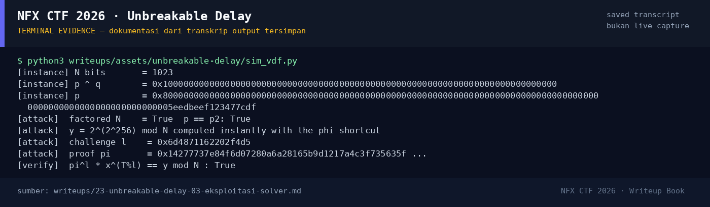

# Unbreakable Delay — Evidence / Bukti

1 screenshot2 transkrip / script

[← Overview](23-unbreakable-delay.md) · [Index](index.md)

## Arsip Evidence

> Semua file di bawah berasal dari folder `assets/unbreakable-delay/`. Screenshot ditempel langsung; file teks/script ditautkan.

### Screenshot

<figure><figcaption>98-terminal-evidence.png</figcaption></figure>

### Transkrip / file pendukung

- [`sim-output.txt`](assets/unbreakable-delay/sim-output.txt)
- [`sim_vdf.py`](assets/unbreakable-delay/sim_vdf.py)

## Tabel Evidence

| Bukti | File | Keterangan |
|---|---|---|
| Flag tersimpan | `flags/misc/UnbreakableDelay.txt` | Flag |
| Log submit | `work/wave2_submit_parallel.jsonl` | `"Correct! +500 points."` |
| Demo solver | `assets/unbreakable-delay/sim_vdf.py` | XOR factoring + phi shortcut |
| Output demo | `assets/unbreakable-delay/sim-output.txt` | Verifikasi matematis |
| Status service | `work/ENDPOINTS.md`, `misc/SERVICES.md` | Port historis / stopped |