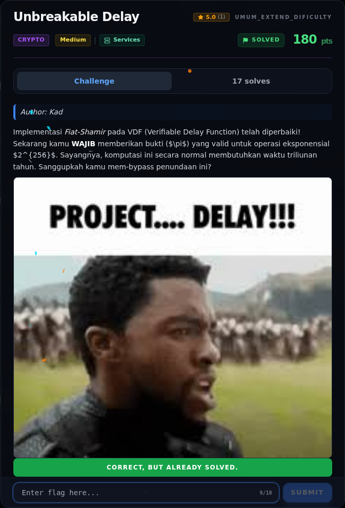

# Unbreakable Delay — Flag & Verifikasi

[← Overview](23-unbreakable-delay.md) · [Index](index.md)

> **Langkah 6/8 — Flag.** Verifikasi (log submit asli):
>
> **Titik penting:** NFX{x0r_f4ct0r1ng_4nd_f4st_vdf_byp4ss_m4k3s_1t_h4rd}
>
> **Berikutnya:** [Bukti / Evidence](23-unbreakable-delay-07-bukti-evidence.md)

> **Flag:** `NFX{x0r_f4ct0r1ng_4nd_f4st_vdf_byp4ss_m4k3s_1t_h4rd}`
> **Status:** `VERIFIED`

```text
NFX{x0r_f4ct0r1ng_4nd_f4st_vdf_byp4ss_m4k3s_1t_h4rd}
```

Verifikasi (log submit asli):

```json
{"time": 1794056594.077969, "id": "166046e6-4804-4104-ad43-f5b48ee768ff",
 "title": "Unbreakable Delay",
 "flag": "NFX{x0r_f4ct0r1ng_4nd_f4st_vdf_byp4ss_m4k3s_1t_h4rd}",
 "http": 200,
 "result": {"success": true, "message": "Correct! +500 points."}}
```

Status: **verified platform**. Detail protokol service tetap `[REKONSTRUKSI]`
karena tidak ada source/instance lokal.

### Bukti submit di platform



*Submit flag di platform: `CORRECT, BUT ALREADY SOLVED.`*

> **Bukti submit:** screenshot form challenge di atas menampilkan `CORRECT, BUT ALREADY SOLVED.`
