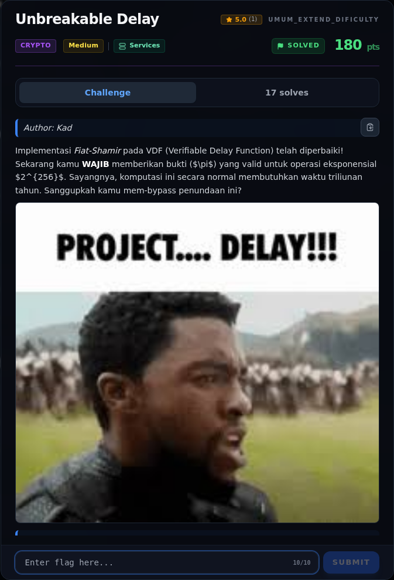
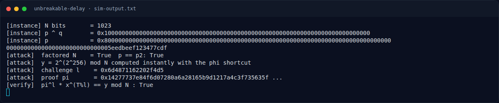
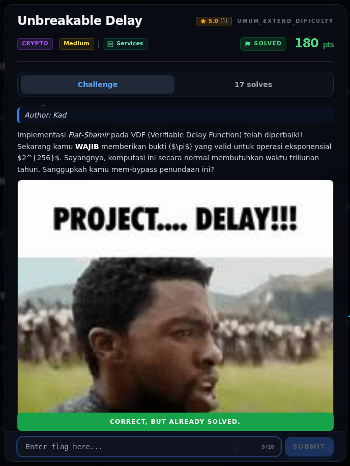

# Unbreakable Delay — Evidence / Bukti

3 screenshot2 transkrip / script

[← Overview](23-unbreakable-delay.md) · [Index](index.md)

> **Langkah 7/8 — Bukti / Evidence.** Bukti / Evidence
>
> **Titik penting:** arsip screenshot dan transkrip
>
> **Berikutnya:** [Referensi](23-unbreakable-delay-08-referensi.md)

## Arsip Evidence

> Semua file berasal dari `assets/unbreakable-delay/`. Screenshot platform dan terminal adalah bukti asli dari sesi solve; transkrip mentah tetap ditautkan di bagian bawah.

### Platform

<figure><figcaption>00-challenge-platform.png</figcaption></figure>

*Challenge brief asli di platform NFX CTF 2026.*

<figure><figcaption>Terminal evidence (real)</figcaption></figure>

*Terminal evidence (real).*

### Terminal (arsip sesi)

<figure><figcaption>term-sim-output.png</figcaption></figure>

*Terminal evidence — `sim-output.txt` (arsip transkrip sesi solve).*

### Transkrip mentah & script

- [`sim-output.txt`](assets/unbreakable-delay/sim-output.txt)
- [`sim_vdf.py`](assets/unbreakable-delay/sim_vdf.py)

## Validasi platform (real)

*Screenshot asli dari platform NFX CTF 2026. Platform menjawab
`CORRECT, BUT ALREADY SOLVED.` untuk flag ini.*

## Tabel Evidence

| Bukti | File | Keterangan |
|---|---|---|
| Flag tersimpan | `flags/misc/UnbreakableDelay.txt` | Flag |
| Log submit | `work/wave2_submit_parallel.jsonl` | `"Correct! +500 points."` |
| Demo solver | `assets/unbreakable-delay/sim_vdf.py` | XOR factoring + phi shortcut |
| Output demo | `assets/unbreakable-delay/sim-output.txt` | Verifikasi matematis |
| Status service | `work/ENDPOINTS.md`, `misc/SERVICES.md` | Port historis / stopped |