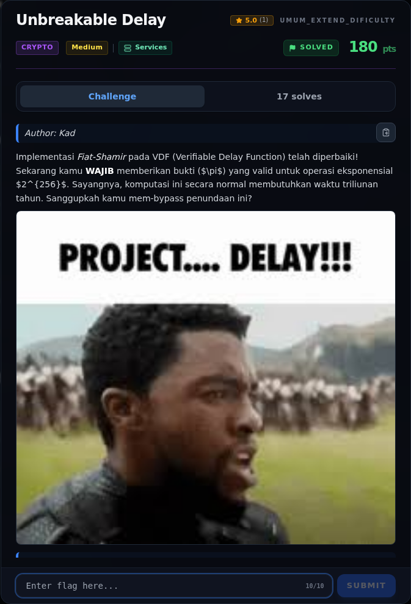

# Unbreakable Delay — Referensi

[← Overview](23-unbreakable-delay.md) · [Index](index.md)

> **Langkah 8/8 — Referensi.** Referensi
>
> **Titik penting:** —
>
> **Selesai.** Kembali ke [Overview](23-unbreakable-delay.md).

- Boneh, Bünz, Fisch, *A Survey of Two Verifiable Delay Functions* (2018).
- Wesolowski, *Efficient Verifiable Delay Functions* (2019).
- Pietrzak, *Simple Verifiable Delay Functions* (2018).
- Rivest, Shamir, Adleman — kesulitan faktorisasi RSA.

### Evidence langkah ini

*Challenge brief asli di platform NFX CTF 2026.*
