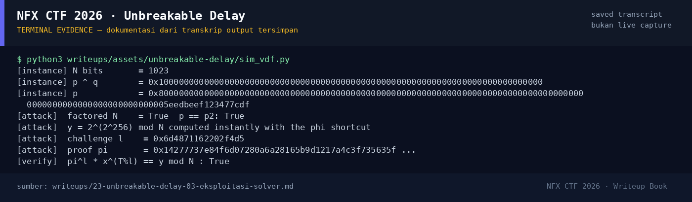

# Unbreakable Delay

Track Umum / Extend · CryptoMedium360 poinVERIFIED

| Field | Nilai |
|---|---|
| Event | `umum_Extend` |
| Kategori | `Crypto` |
| Difficulty | `Medium` |
| Poin | `360` |
| Author | `Kad` |
| Solves | `8` |
| Tools | python3, sage, git |
| Flag | `NFX{x0r_f4ct0r1ng_4nd_f4st_vdf_byp4ss_m4k3s_1t_h4rd}` |
| Status | `VERIFIED` |

[← Kembali ke Index](index.md)

## Ringkasan

> **Catatan artefak:** challenge ini **tidak punya file lampiran** di workspace
> dan service-nya sudah tidak menerima koneksi saat writeup ditulis
> (`tcp://s1.nfx.my.id:43206` → connection refused; inventaris mencatat port
> 1337/stopped). Karena itu bagian protokol ditandai **[REKONSTRUKSI]** dan
> demo solver di bawah adalah **simulasi**, bukan reproduksi instance asli.
> Flag-nya sendiri **terverifikasi** lewat submit platform.
## TL;DR

- Challenge meminta **bukti Fiat–Shamir** untuk VDF `y = 2^(2^256) mod N`.
  Evaluasi naif membutuhkan `2^256` squaring berurutan — tidak mungkin.
- Kunci bypass ada di nama flag: **XOR factoring** + **fast VDF bypass**.
- Jika `N` dapat difaktorkan (karena `p` dan `q` punya relasi XOR yang
  terstruktur), maka `φ(N)` diketahui. Dengan `φ(N)`, eksponen `2^256` dapat
  direduksi modulo `φ(N)`, dan `y` dihitung seketika.
- Bukti `π` juga dapat dipalsukan dengan cara yang sama:
  `π = x^(⌊T/l⌋ mod φ(N))`, lalu verifier memeriksa
  `π^l · x^(T mod l) ≡ y (mod N)`.
- Flag: `NFX{x0r_f4ct0r1ng_4nd_f4st_vdf_byp4ss_m4k3s_1t_h4rd}`.

Pratinjau evidence. Buka halaman <a href="23-unbreakable-delay-05-bukti-evidence.html">Evidence / Bukti</a> untuk semua screenshot dan transkrip.

## Navigasi Halaman

<a class="nx-page-card" href="23-unbreakable-delay-01-recon.html"><b>Recon</b>Enumerasi target dan bukti awal</a>
<a class="nx-page-card" href="23-unbreakable-delay-02-analisis.html"><b>Analisis</b>Membaca alur dan akar masalah</a>
<a class="nx-page-card" href="23-unbreakable-delay-03-eksploitasi-solver.html"><b>Eksploitasi / Solver</b>Langkah exploit dan solver</a>
<a class="nx-page-card" href="23-unbreakable-delay-04-flag.html"><b>Flag</b>Flag dan verifikasi platform</a>
<a class="nx-page-card" href="23-unbreakable-delay-05-bukti-evidence.html"><b>Bukti / Evidence</b>Screenshot, transkrip, dan artefak</a>
<a class="nx-page-card" href="23-unbreakable-delay-06-referensi.html"><b>Referensi</b>Sumber dan bacaan lanjutan</a>

