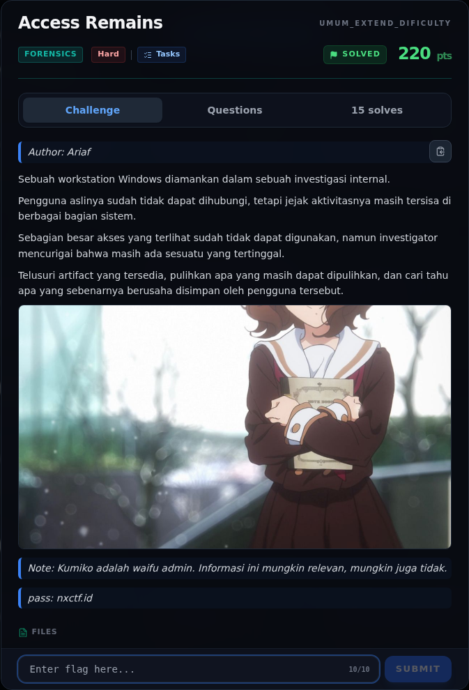

# Access Remains — Deskripsi challenge

[← Overview](24-access-remains.md) · [Index](index.md)

> **Langkah 1/11 — Deskripsi challenge.** Deskripsi challenge
>
> **Titik penting:** —
>
> **Berikutnya:** [Recon Artefak](24-access-remains-02-recon-artefak.md)

## 1.1 Deskripsi challenge

> Author: Ariaf
>
> Sebuah workstation Windows diamankan dalam sebuah investigasi internal.
>
> Pengguna aslinya sudah tidak dapat dihubungi, tetapi jejak aktivitasnya masih tersisa di berbagai bagian sistem.
>
> Sebagian besar akses yang terlihat sudah tidak dapat digunakan, namun investigator mencurigai bahwa masih ada sesuatu yang tertinggal.
>
> Telusuri artifact yang tersedia, pulihkan apa yang masih dapat dipulihkan, dan cari tahu apa yang sebenarnya berusaha disimpan oleh pengguna tersebut.
>
> Note: Kumiko adalah waifu admin. Informasi ini mungkin relevan, mungkin juga tidak.
>
> pass: nxctf.id

### Evidence langkah ini

*Challenge brief asli di platform NFX CTF 2026.*
