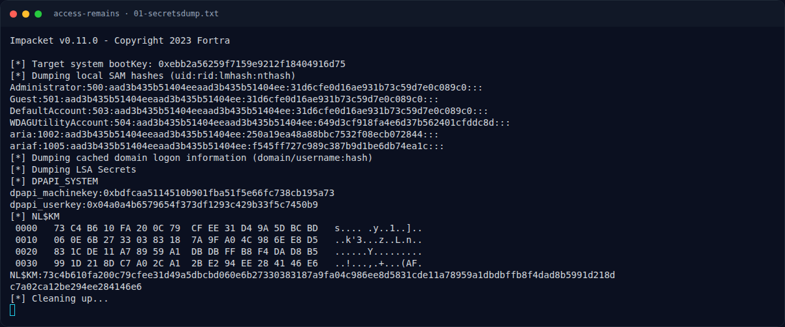

# Access Remains — Triage awal

[← Overview](24-access-remains.md) · [Index](index.md)

## 1.4 Triage awal

`file` menunjukkan registry hive dan file DPAPI:

```text
SAM:        MS Windows registry file, NT/2000 or above
SYSTEM:     MS Windows registry file, NT/2000 or above
SECURITY:   MS Windows registry file, NT/2000 or above
NTUSER.DAT: MS Windows registry file, NT/2000 or above
bb24f650-...: data
B0294E...:    data
Kumiko.zip:   Zip archive data, at least v2.0 to extract, compression method=deflate
```

`Kumiko.zip` terlihat sebagai ZIP terenkripsi; `kumiko03.jpg` berukuran 98.795 byte dan akan menjadi kunci visual nanti.

### Evidence langkah ini



*Terminal evidence — `01-secretsdump.txt` (arsip transkrip sesi solve).*

**Berkas mentah langkah ini:**

- [`01-secretsdump.txt`](assets/access-remains/01-secretsdump.txt)
