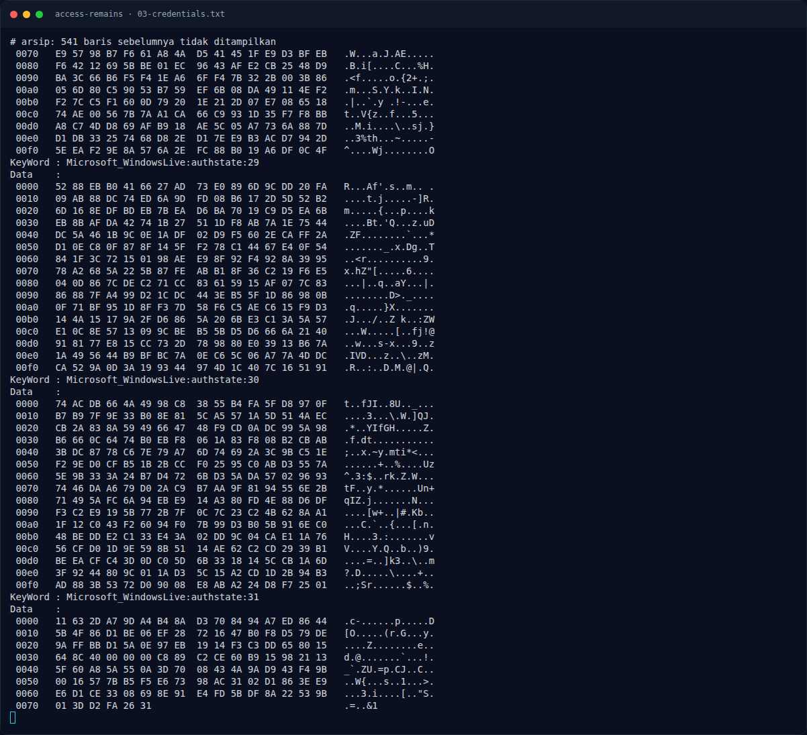

# Access Remains — Analisis Artefak

[← Overview](24-access-remains.md) · [Index](index.md)

## 2.2 DPAPI masterkey

Masterkey user `ariaf`:

```text
AppData/Roaming/Microsoft/Protect/S-1-5-21-3304503823-3980900213-1333018566-1005/bb24f650-d046-439c-a88b-ab8f89ba61a4
```

Dekripsi dengan password `ariafe006`:

```bash
$ python3 /usr/share/doc/python3-impacket/examples/dpapi.py masterkey \
    -file bb24f650-d046-439c-a88b-ab8f89ba61a4 \
    -sid S-1-5-21-3304503823-3980900213-1333018566-1005 \
    -password 'ariafe006'
Impacket v0.11.0

[MASTERKEYFILE]
Version     :        2 (2)
Guid        : bb24f650-d046-439c-a88b-ab8f89ba61a4
Flags       :        5 (5)
Policy      :        0 (0)
MasterKeyLen: 000000b0 (176)
BackupKeyLen: 00000090 (144)
CredHistLen : 00000014 (20)
DomainKeyLen: 00000000 (0)

Decrypted key with User Key (SHA1)
Decrypted key: 0x2cbc5b2e483dae00c5593617eb517b8cabec639f354ca8f75b4296e82f3c8d2e83f2ce9a6ae64e3f1f849098f985b2d64e74e81affd37021392b7ba7b4635b55
```

## 2.3 Credential Manager

Dua file credential:

- Local: `AppData/Local/Microsoft/Credentials/DFBE70A7E5CC19A398EBF1B96859CE5D`
- Roaming: `AppData/Roaming/Microsoft/Credentials/B0294E9651990C1435CA6300E4BB2378`

Dekripsi dengan masterkey:

```bash
MK=0x2cbc5b2e483dae00c5593617eb517b8cabec639f354ca8f75b4296e82f3c8d2e83f2ce9a6ae64e3f1f849098f985b2d64e74e81affd37021392b7ba7b4635b55
python3 /usr/share/doc/python3-impacket/examples/dpapi.py credential \
  -file B0294E9651990C1435CA6300E4BB2378 -key $MK
```

Output penting:

```text
[CREDENTIAL]
LastWritten : 2026-08-18 16:49:31
Flags       : 0x00000030 (CRED_FLAGS_REQUIRE_CONFIRMATION|CRED_FLAGS_WILDCARD_MATCH)
Persist     : 0x00000003 (CRED_PERSIST_ENTERPRISE)
Type        : 0x00000001 (CRED_TYPE_GENERIC)
Target      : LegacyGeneric:target=AccessRemains:WaifuVault
Username    : ariaf@access-remains.local
Unknown     : KumikoOumae2107!@
```

Credential lokal adalah `WindowsLive:target=virtualapp/didlogical` (tidak relevan). Credential roaming memberi password **`KumikoOumae2107!@`** untuk target `AccessRemains:WaifuVault`.

### Evidence langkah ini



*Terminal evidence — `03-credentials.txt` (arsip transkrip sesi solve).*

**Berkas mentah langkah ini:**

- [`03-credentials.txt`](assets/access-remains/03-credentials.txt)
