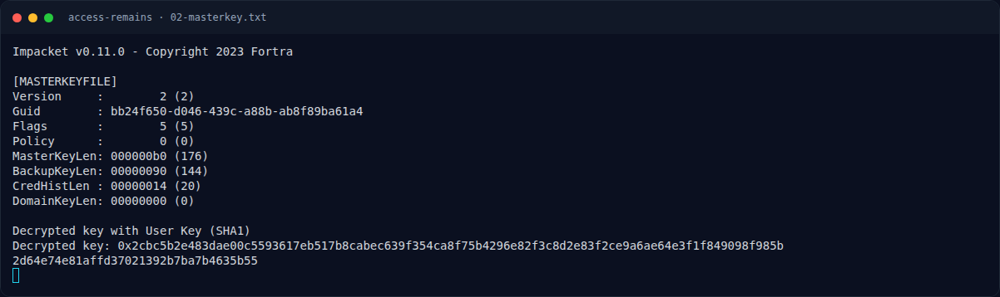
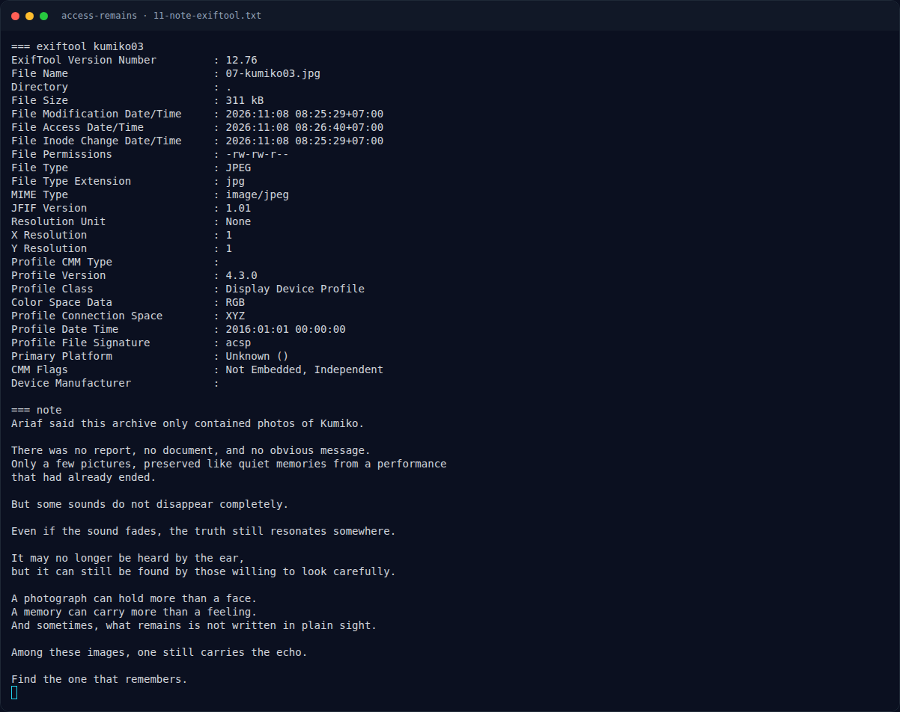

# Access Remains — Analisis Artefak

[← Overview](24-access-remains.md) · [Index](index.md)

## 2.4 Membuka Kumiko.zip

```bash
$ 7z x -y -p'KumikoOumae2107!@' Kumiko.zip
...
Everything is Ok

Files: 6
Size:       531182
Compressed: 530710
```

Isi:

```text
kumiko01.jpg
kumiko02.jpg
kumiko03.jpg
kumiko04.jpg
kumiko05.jpg
note.txt
```

`note.txt`:

```text
Ariaf said this archive only contained photos of Kumiko.

There was no report, no document, and no obvious message.
Only a few pictures, preserved like quiet memories from a performance
that had already ended.

But some sounds do not disappear completely.

Even if the sound fades, the truth still resonates somewhere.

It may no longer be heard by the ear,
but it can still be found by those willing to look carefully.

A photograph can hold more than a face.
A memory can carry more than a feeling.
And sometimes, what remains is not written in plain sight.

Among these images, one still carries the echo.

Find the one that remembers.
```

Petunjuk: “one still carries the echo” / “one that remembers” → satu gambar menyimpan pesan. `kumiko03.jpg` adalah yang berbeda: 387×755, baseline JPEG, memiliki ICC profile, dan pada bagian bawah terdapat overlay teks.

## 2.5 Ekstraksi teks dari `kumiko03.jpg`

`exiftool` tidak menemukan flag di metadata. Secara visual, bagian bawah gambar memuat teks:

```text
{3E2D6090E7EEB47D5
38FC27AC2789C02}
```

Penggabungan:

```text
3E2D6090E7EEB47D5 + 38FC27AC2789C02
= 3E2D6090E7EEB47D538FC27AC2789C02
```

32 karakter hex, dapat dikelompokkan menjadi 4 grup 8:

```text
3E2D6090  E7EEB47D  538FC27A  C2789C02
```

### Evidence langkah ini



*Terminal evidence — `02-masterkey.txt` (arsip transkrip sesi solve).*



*Terminal evidence — `11-note-exiftool.txt` (arsip transkrip sesi solve).*

**Berkas mentah langkah ini:**

- [`02-masterkey.txt`](assets/access-remains/02-masterkey.txt)
- [`11-note-exiftool.txt`](assets/access-remains/11-note-exiftool.txt)
