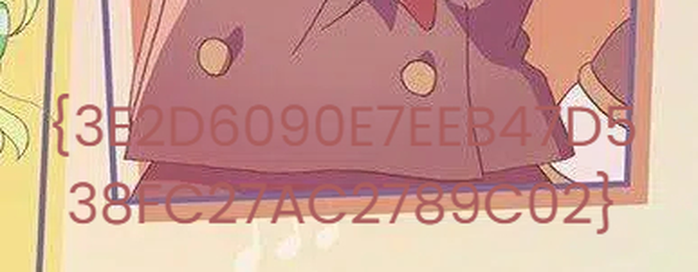
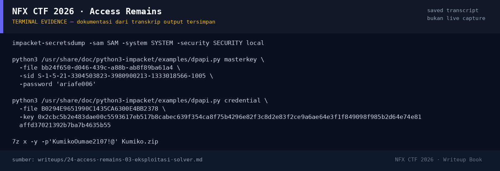

# Access Remains — Evidence / Bukti

3 screenshot11 transkrip / script

[← Overview](24-access-remains.md) · [Index](index.md)

## Arsip Evidence

> Semua file di bawah berasal dari folder `assets/access-remains/`. Screenshot ditempel langsung; file teks/script ditautkan.

### Screenshot

<figure><figcaption>07-kumiko03.jpg</figcaption></figure>
<figure><figcaption>08-flag-crop.png</figcaption></figure>
<figure><figcaption>98-terminal-evidence.png</figcaption></figure>

### Transkrip / file pendukung

- [`00-file-tree.txt`](assets/access-remains/00-file-tree.txt)
- [`01-secretsdump.txt`](assets/access-remains/01-secretsdump.txt)
- [`02-masterkey.txt`](assets/access-remains/02-masterkey.txt)
- [`03-credentials.txt`](assets/access-remains/03-credentials.txt)
- [`04-unzip.txt`](assets/access-remains/04-unzip.txt)
- [`05-Kumiko.zip`](assets/access-remains/05-Kumiko.zip)
- [`06-note.txt`](assets/access-remains/06-note.txt)
- [`09-hashes.txt`](assets/access-remains/09-hashes.txt)
- [`10-ntlm-verify.txt`](assets/access-remains/10-ntlm-verify.txt)
- [`11-note-exiftool.txt`](assets/access-remains/11-note-exiftool.txt)
- [`solve_access.sh`](assets/access-remains/solve_access.sh)

## Tabel Evidence

| Bukti | File | Keterangan |
|---|---|---|
| File tree | `assets/access-remains/00-file-tree.txt` | struktur Evidence |
| SAM/SYSTEM | `assets/access-remains/01-secretsdump.txt` | bootkey + NTLM |
| Masterkey | `assets/access-remains/02-masterkey.txt` | decrypt DPAPI |
| Credential | `assets/access-remains/03-credentials.txt` | target/username/password |
| ZIP extract | `assets/access-remains/04-unzip.txt` | 7z output |
| ZIP | `assets/access-remains/05-Kumiko.zip` | arsip terenkripsi |
| Note | `assets/access-remains/06-note.txt` | petunjuk “one that remembers” |
| Gambar | `assets/access-remains/07-kumiko03.jpg` | gambar dengan overlay |
| Crop flag | `assets/access-remains/08-flag-crop.png` | teks flag diperbesar |
| Hash | `assets/access-remains/09-hashes.txt` | sha256 artefak |
| NTLM verify | `assets/access-remains/10-ntlm-verify.txt` | verifikasi kandidat |
| Script | `assets/access-remains/solve_access.sh` | reproduksi alur |